[English](README.md) · [简体中文](README.zh-CN.md) · [繁體中文](README.zh-TW.md) · [日本語](README.ja.md) · [한국어](README.ko.md)

# REA Atlas: 리버스 엔지니어링 프로젝트 지도 (rea 태그 포함)

오픈 리버스 엔지니어링 프로젝트 지도입니다. 게임 디컴파일, 정적 리컴파일, 재구현, 에셋 추출 도구, 범용 RE 도구, 앱/프로토콜/펌웨어 분석을 수록하며, 각 항목에 [morluto/rea](https://github.com/morluto/rea)(Reverse Engineer Anything) 사용 여부 **Uses rea: Yes / No / Unverified**를 표시합니다. Yes는 공개 근거가 있을 때만 표시합니다.

> 비공식이며 morluto/rea와 관련이 없습니다.

## 목차

- [REA를 사용한 프로젝트 (증거 표시 서브셋)](#rea를-사용한-프로젝트-증거-표시-서브셋)
- [게임](#게임)
  - [패미컴 / NES](#패미컴--nes)
  - [슈퍼 패미컴 / SNES](#슈퍼-패미컴--snes)
  - [메가 드라이브 / Genesis](#메가-드라이브--genesis)
  - [세가 새턴](#세가-새턴)
  - [게임보이](#게임보이)
  - [게임보이 어드밴스](#게임보이-어드밴스)
  - [닌텐도 64](#닌텐도-64)
  - [게임큐브](#게임큐브)
  - [Wii](#wii)
  - [닌텐도 DS](#닌텐도-ds)
  - [닌텐도 3DS](#닌텐도-3ds)
  - [PlayStation](#playstation)
  - [PlayStation 2](#playstation-2)
  - [Xbox / Xbox 360](#xbox--xbox-360)
  - [PC / DOS / PC-98](#pc--dos--pc-98)
- [앱 / Electron / 데스크톱](#앱--electron--데스크톱)
- [프로토콜 / 하드웨어](#프로토콜--하드웨어)
- [펌웨어 / 드라이버](#펌웨어--드라이버)
- [보안 / 평가](#보안--평가)
- [리버싱 도구](#리버싱-도구)
- [REA 공식 쇼케이스](#rea-공식-쇼케이스)

## REA를 사용한 프로젝트 (증거 표시 서브셋)

_선택 필터: 다음은 REA를 사용했다는 공개 증거가 있는 프로젝트입니다. 지도의 대부분은 일반 역공학 프로젝트이며 REA는 필수가 아닙니다._

<table>
<tr><th width="170">이미지</th><th>프로젝트</th><th>소개</th><th>rea 사용</th><th>이미지 출처</th></tr>
<tr><td><a href="https://github.com/morluto/rea/discussions/2254">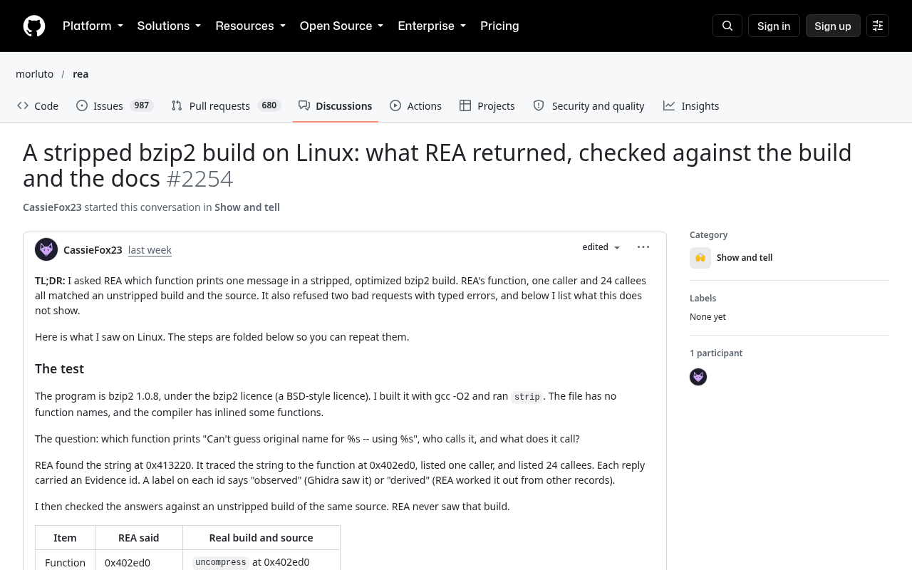</a></td><td><a href="https://github.com/morluto/rea/discussions/2254"><b>REA discussion #2254</b></a></td><td>심볼 없는 bzip2를 분석하고 실제 빌드와 대조</td><td>✅ 예</td><td>자체 스크린샷</td></tr>
<tr><td>—</td><td><a href="https://github.com/aicodeking/leanrea"><b>leanrea</b></a> aicodeking</td><td>REA MCP 계층을 대체하는 경량 스킬. 에이전트가 CLI 도구를 직접 구동</td><td>✅ 예</td><td>—</td></tr>
<tr><td>—</td><td><a href="https://github.com/cranebeaker/coop-anything"><b>coop-anything</b></a> cranebeaker</td><td>REA로 진입점을 조사해 싱글 플레이 게임에 협동 모드를 추가하는 MCP 서버</td><td>✅ 예</td><td>—</td></tr>
<tr><td>—</td><td><a href="https://github.com/Caho1/open-claude-ui"><b>open-claude-ui</b></a> Caho1</td><td>REA로 Claude Desktop UI와 상호작용 물리를 추출한 고충실도 재구현</td><td>✅ 예</td><td>—</td></tr>
<tr><td>—</td><td><a href="https://github.com/MiaAI-Lab/sparkDash"><b>sparkDash</b></a> MiaAI-Lab</td><td>장시간 REA 분석 작업을 통합하고 결과를 온디맨드로 로드하는 멀티 디바이스 대시보드</td><td>✅ 예</td><td>—</td></tr>
<tr><td></td><td><a href="https://github.com/michaelshimeles/terminal-rs"><b>terminal-rs</b></a> michaelshimeles</td><td>Rust로 만든 블룸버그 스타일 트레이딩 터미널</td><td>✅ 예</td><td>프로젝트 README</td></tr>
<tr><td></td><td><a href="https://github.com/ShadowSwaps/REA-Reconstruction-Companion"><b>REA-Reconstruction-Companion</b></a> ShadowSwaps</td><td>재구성을 항상 증거와 연결하는 에이전트 스킬</td><td>✅ 예</td><td>저장소 카드</td></tr>
<tr><td></td><td><a href="https://github.com/michaelshimeles/rec-rs"><b>rec-rs</b></a> michaelshimeles</td><td>OBS를 참고한 Rust 기반 빠른 macOS 녹화 도구</td><td>✅ 예</td><td>프로젝트 README</td></tr>
<tr><td>—</td><td><a href="https://github.com/Xiangyu-CAS/rea-capcut"><b>rea-capcut</b></a> Xiangyu-CAS</td><td>REA로 CapCut을 분석해 다시 만든 오픈소스 오프라인 영상 편집기</td><td>✅ 예</td><td>—</td></tr>
<tr><td></td><td><a href="https://github.com/N0zoM1z0/dx-ball"><b>dx-ball</b></a> N0zoM1z0</td><td>DX-Ball 1.07을 C/C++로 재구성하고 원본 x86과 대조 테스트</td><td>✅ 예</td><td>프로젝트 README</td></tr>
<tr><td></td><td><a href="https://github.com/michaelshimeles/sketch"><b>sketch</b></a> michaelshimeles</td><td>Paper를 연구해 만든 Rust 무한 디자인 캔버스</td><td>✅ 예</td><td>프로젝트 README</td></tr>
<tr><td>—</td><td><a href="https://github.com/giveen/decomp.anything"><b>decomp.anything</b></a> giveen</td><td>업데이트 중단된 매칭 디컴파일러 decomp.wtf의 활성 포크. Windows/Linux 바이너리 지원과 REA 브리지를 추가해 게임 외 프로그램도 AI가 역공학할 수 있게 함.</td><td>✅ 예</td><td>—</td></tr>
<tr><td></td><td><a href="https://github.com/Moxnatiy/OpenBattlefield2"><b>OpenBattlefield2</b></a> Moxnatiy</td><td>배틀필드 2 엔진을 C++20으로 클린룸 재구현(보유한 게임 사용)</td><td>✅ 예</td><td>프로젝트 README</td></tr>
<tr><td></td><td><a href="https://github.com/czcdr/dsh-plugin-rea"><b>dsh-plugin-rea</b></a> czcdr</td><td>DeepSeek Harness에서 REA 사용, Ghidra 자동 설치</td><td>✅ 예</td><td>프로젝트 README</td></tr>
<tr><td></td><td><a href="https://github.com/0xshlomil/ida-free-mcp"><b>ida-free-mcp</b></a> 0xshlomil</td><td>MCP로 AI 에이전트가 IDA Free 사용</td><td>✅ 예</td><td>저장소 카드</td></tr>
<tr><td></td><td><a href="https://github.com/lxistired/ledger-reborn"><b>ledger-reborn</b></a> lxistired</td><td>QuickBooks for Mac을 참고한 로컬 우선 회계 앱</td><td>✅ 예</td><td>프로젝트 README</td></tr>
<tr><td>—</td><td><a href="https://github.com/glauberlima/open-scrantic"><b>open-scrantic</b></a> glauberlima</td><td>REA로 역공학한 1992년 Johnny Castaway 화면 보호기의 Rust 재구현</td><td>✅ 예</td><td>—</td></tr>
<tr><td></td><td><a href="https://github.com/N0zoM1z0/th04"><b>th04</b></a> N0zoM1z0</td><td>동방환상향(PC-98)을 읽을 수 있는 소스로, 원래 컴파일러로 검증</td><td>✅ 예</td><td>프로젝트 README</td></tr>
<tr><td>—</td><td><a href="https://github.com/rodneypantonial/sims3-modernization"><b>sims3-modernization</b></a> rodneypantonial</td><td>최신 PC에서 심즈 3 끊김과 크래시 줄이기</td><td>✅ 예</td><td>—</td></tr>
<tr><td>—</td><td><a href="https://github.com/tanepiper/game-frame"><b>game-frame</b></a> tanepiper</td><td>배포 파일로 에이전트가 게임을 역공학하는 프레임워크</td><td>✅ 예</td><td>—</td></tr>
<tr><td></td><td><a href="https://github.com/alexmi256/rea-agent-docker"><b>rea-agent-docker</b></a> alexmi256</td><td>Ghidra·Hopper·IDA 변형이 있는 REA Docker 이미지</td><td>✅ 예</td><td>저장소 카드</td></tr>
<tr><td>—</td><td><a href="https://github.com/EndLess728/MiTV-Remote"><b>MiTV-Remote</b></a> EndLess728</td><td>Mac·안드로이드·아이폰에서 Wi-Fi로 샤오미 TV 조작</td><td>✅ 예</td><td>—</td></tr>
<tr><td>—</td><td><a href="https://github.com/nicolvus/a6000-fw-decomp"><b>a6000-fw-decomp</b></a> nicolvus</td><td>REA와 Ghidra로 소니 A6000 펌웨어 분석</td><td>✅ 예</td><td>—</td></tr>
<tr><td></td><td><a href="https://github.com/ucodia/desktop-games-nostalgia"><b>desktop-games-nostalgia</b></a> ucodia</td><td>다시 데스크톱 부수기: Gemtree의 2000년작을 macOS와 웹으로</td><td>✅ 예</td><td>프로젝트 README</td></tr>
<tr><td></td><td><a href="https://github.com/sickpyramid/ReaFuse"><b>ReaFuse</b></a> sickpyramid</td><td>REA로 두 JS/TS 프로젝트를 하나로 합치기</td><td>✅ 예</td><td>저장소 카드</td></tr>
<tr><td></td><td><a href="https://github.com/pablodiazjorge/rea-lab"><b>rea-lab</b></a> pablodiazjorge</td><td>Windows + Ghidra 실습과 사전 등록된 REA 평가</td><td>✅ 예</td><td>저장소 카드</td></tr>
<tr><td></td><td><a href="https://github.com/grisuno/VSL-DSP"><b>VSL-DSP</b></a> grisuno</td><td>PreSonus AudioBox VSL용 Linux 커널 모듈</td><td>✅ 예</td><td>저장소 카드</td></tr>
<tr><td></td><td><a href="https://github.com/NullLabTests/OpenBSD_netcat_REA"><b>OpenBSD_netcat_REA</b></a> NullLabTests</td><td>REA와 Ghidra로 netcat-openbsd 정적 분석</td><td>✅ 예</td><td>프로젝트 README</td></tr>
<tr><td></td><td><a href="https://github.com/iammukeshm/hexgrab"><b>hexgrab</b></a> iammukeshm</td><td>PowerToys 바이너리를 분석해 만든 작은 Windows 색상 선택기</td><td>✅ 예</td><td>저장소 카드</td></tr>
<tr><td></td><td><a href="https://github.com/cudanexus/vd-streamer-linux"><b>vd-streamer-linux</b></a> cudanexus</td><td>Linux 데스크톱을 Quest·Pico 헤드셋으로 스트리밍</td><td>✅ 예</td><td>저장소 카드</td></tr>
<tr><td></td><td><a href="https://github.com/zhaofeng130/dsh-rea"><b>dsh-rea</b></a> zhaofeng130</td><td>DeepSeek Harness에 REA 스킬과 도구 추가</td><td>✅ 예</td><td>저장소 카드</td></tr>
<tr><td></td><td><a href="https://github.com/pablodiazjorge/rea-casebook"><b>rea-casebook</b></a> pablodiazjorge</td><td>Claude Code의 모든 결론에 실제 REA 증거를 인용하게</td><td>✅ 예</td><td>프로젝트 README</td></tr>
<tr><td>—</td><td><a href="https://github.com/B-Howell/soundconnect-desktop"><b>soundconnect-desktop</b></a> B-Howell</td><td>Windows 데스크톱에서 소니 블루투스 헤드폰 제어</td><td>✅ 예</td><td>—</td></tr>
<tr><td></td><td><a href="https://github.com/tuunanet/rea-ski-or-die-reconstruction"><b>rea-ski-or-die-reconstruction</b></a> tuunanet</td><td>Ski or Die 눈싸움을 Rust + SDL2로 재구현(에셋은 직접 준비)</td><td>✅ 예</td><td>프로젝트 README</td></tr>
<tr><td></td><td><a href="https://github.com/OpenRsG/GunZRs"><b>GunZRs</b></a> OpenRsG</td><td>GunZ: The Duel을 Rust + Bevy로 부활</td><td>✅ 예</td><td>프로젝트 README</td></tr>
<tr><td></td><td><a href="https://github.com/sheilacraig/dsh-rea-mcp"><b>dsh-rea-mcp</b></a> sheilacraig</td><td>설정만으로 DeepSeek Harness에 REA 연결</td><td>✅ 예</td><td>저장소 카드</td></tr>
<tr><td></td><td><a href="https://github.com/a-barzanti/ai-rebuilds"><b>ai-rebuilds</b></a> a-barzanti</td><td>버려진 게임을 브라우저로 되살림, 원본 파일 미포함</td><td>✅ 예</td><td>저장소 카드</td></tr>
<tr><td></td><td><a href="https://github.com/Nowng/rea-mcp"><b>rea-mcp</b></a> Nowng</td><td>LM Studio 로컬 모델로 REA 사용</td><td>✅ 예</td><td>저장소 카드</td></tr>
<tr><td></td><td><a href="https://github.com/ya123-4/rea-dsh-plugin"><b>rea-dsh-plugin</b></a> ya123-4</td><td>DeepSeek Harness에 REA MCP 도구 등록</td><td>✅ 예</td><td>저장소 카드</td></tr>
<tr><td></td><td><a href="https://github.com/az9713/wispr-flow-rea-teardown"><b>wispr-flow-rea-teardown</b></a> az9713</td><td>Wispr Flow 음성 파이프라인 해부와 64줄 재구현</td><td>✅ 예</td><td><a href="https://img.youtube.com/vi/FnB9tHKBJXQ/maxresdefault.jpg">동영상 썸네일</a></td></tr>
<tr><td></td><td><a href="https://github.com/KarlssonChristoffer/DiskLens"><b>DiskLens</b></a> KarlssonChristoffer</td><td>WinDirStat처럼 Windows 11 디스크 사용량을 시각화</td><td>✅ 예</td><td>저장소 카드</td></tr>
<tr><td></td><td><a href="https://github.com/cognixws/picode-rea"><b>picode-rea</b></a> cognixws</td><td>PiCode에서 REA 정적 분석 도구 사용</td><td>✅ 예</td><td>저장소 카드</td></tr>
<tr><td></td><td><a href="https://github.com/jinshi666888/rea-playbook"><b>rea-playbook</b></a> jinshi666888</td><td>작은 Electron 타깃이 있는 REA 실습</td><td>✅ 예</td><td>프로젝트 README</td></tr>
<tr><td></td><td><a href="https://github.com/UnknownHacker1/rea-groundtruth"><b>rea-groundtruth</b></a> UnknownHacker1</td><td>REA 보고서를 실제 소스와 대조</td><td>✅ 예</td><td>저장소 카드</td></tr>
<tr><td><a href="https://rea.tools/showcase/dx-ball/">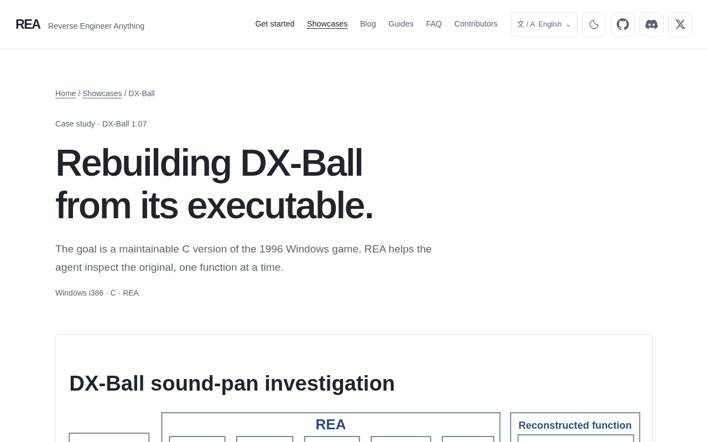</a></td><td><a href="https://rea.tools/showcase/dx-ball/"><b>DX-Ball: sound-pan function</b></a></td><td>REA가 DX-Ball 사운드 함수를 바이트 단위로 같은 C로 복원하는 과정</td><td>✅ 예</td><td>자체 스크린샷</td></tr>
<tr><td><a href="https://rea.tools/showcase/notion/">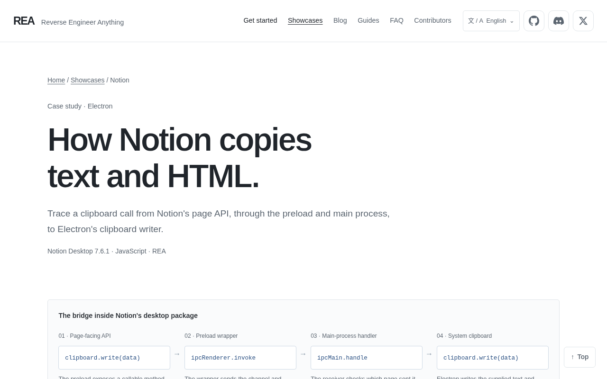</a></td><td><a href="https://rea.tools/showcase/notion/"><b>Notion: Electron clipboard bridge</b></a></td><td>Notion 복사 동작을 페이지에서 IPC, 메인 프로세스까지 추적</td><td>✅ 예</td><td>자체 스크린샷</td></tr>
<tr><td><a href="https://rea.tools/showcase/th04/">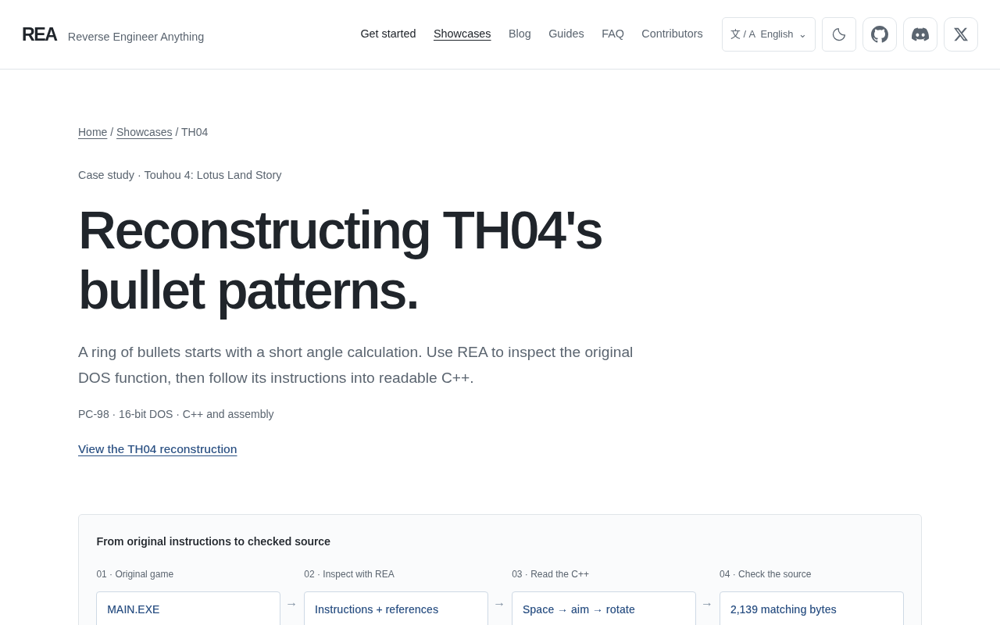</a></td><td><a href="https://rea.tools/showcase/th04/"><b>TH04: PC-98 bullet-ring maths</b></a></td><td>16비트 DOS 코드에서 동방환상향 탄막 각도 계산을 복원</td><td>✅ 예</td><td>자체 스크린샷</td></tr>
<tr><td><a href="https://rea.tools/showcase/aegis/">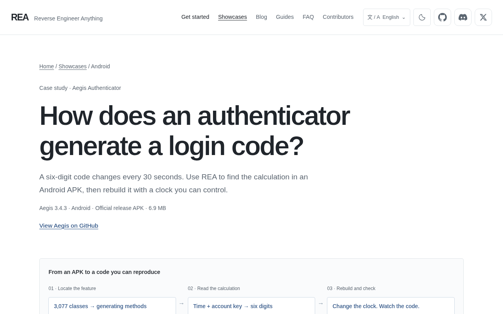</a></td><td><a href="https://rea.tools/showcase/aegis/"><b>Aegis: TOTP code generation</b></a></td><td>Aegis 안드로이드 앱이 2단계 인증 코드를 만드는 방식을 해부</td><td>✅ 예</td><td>자체 스크린샷</td></tr>
<tr><td><a href="https://rea.tools/showcase/ctf/">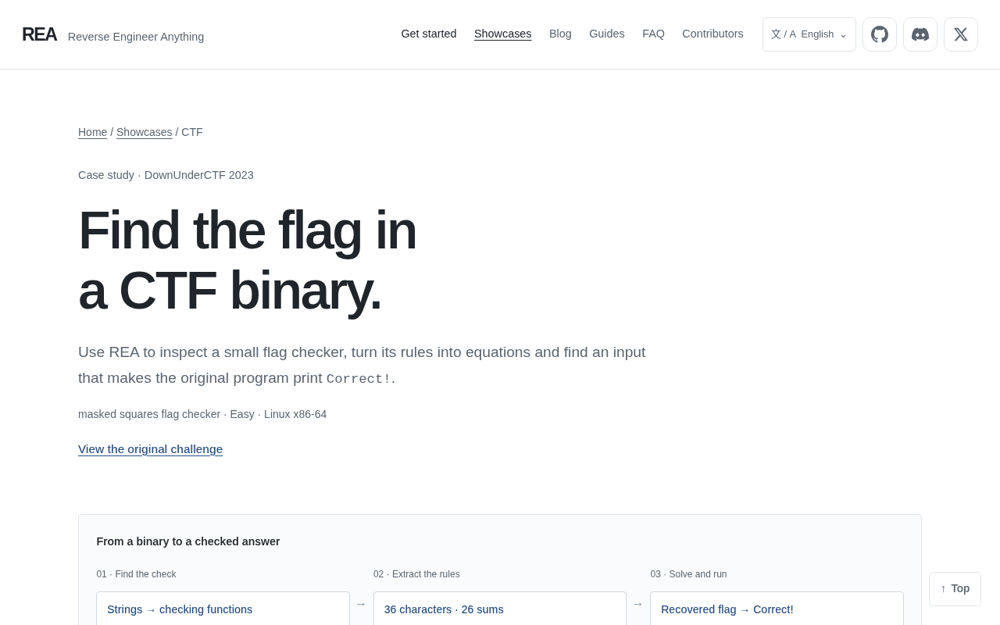</a></td><td><a href="https://rea.tools/showcase/ctf/"><b>CTF: flag checker</b></a></td><td>DownUnderCTF 2023 리버싱 문제를 단계별로 풀이</td><td>✅ 예</td><td>자체 스크린샷</td></tr>
<tr><td></td><td><a href="https://github.com/AdamLinCodes/AdamTerm"><b>AdamTerm</b></a> AdamLinCodes</td><td>Ghostty를 살펴보고 만든 미니멀 macOS 터미널</td><td>✅ 예</td><td>프로젝트 README</td></tr>
<tr><td></td><td><a href="https://github.com/az9713/REA-demo"><b>REA-demo</b></a> az9713</td><td>REA가 스스로를 분석, 반증 가능한 예측 포함</td><td>✅ 예</td><td>저장소 카드</td></tr>
<tr><td>—</td><td><a href="https://github.com/chilliesdev/fmseasonhub-re"><b>fmseasonhub-re</b></a> chilliesdev</td><td>REA로 FM Season Hub 앱을 분석한 노트</td><td>✅ 예</td><td>—</td></tr>
<tr><td>—</td><td><a href="https://github.com/carlhako/keen-clone"><b>keen-clone</b></a> carlhako</td><td>REA + Ghidra로 함수 단위 복원한 Commander Keen 1의 네이티브 Linux/SDL2 재구현</td><td>✅ 예</td><td>—</td></tr>
<tr><td>—</td><td><a href="https://github.com/NathanKanaeru/samp-client-re"><b>samp-client-re</b></a> NathanKanaeru</td><td>REA/Ghidra로 아키텍처를 복원한 SA-MP 0.3.DL-R1 클린룸 클라이언트 재구현</td><td>✅ 예</td><td>—</td></tr>
<tr><td>—</td><td><a href="https://github.com/Stijnus/dsh-rev-eng"><b>dsh-rev-eng</b></a> Stijnus</td><td>REA 스킬과 선택적 MCP를 DSH 플러그인으로 패키징. 리버스 엔지니어링 및 Mac 앱 빌드용.</td><td>✅ 예</td><td>—</td></tr>
<tr><td>—</td><td><a href="https://github.com/CurLeaf/dsh-command-rea"><b>dsh-command-rea</b></a> CurLeaf</td><td>DSH /rea 슬래시 명령. 요청을 REA 스킬과 MCP 도구로 라우팅.</td><td>✅ 예</td><td>—</td></tr>
</table>

## 게임

### 패미컴 / NES

#### 디컴파일 / 리컴파일

<table>
<tr><th width="170">이미지</th><th>프로젝트</th><th>소개</th><th>rea 사용</th><th>이미지 출처</th></tr>
<tr><td></td><td><a href="https://github.com/aldonunez/zelda1-disassembly"><b>zelda1-disassembly</b></a> aldonunez</td><td>초대 젤다의 전설(NES) 완전 디스어셈블</td><td>아니요</td><td><a href="https://upload.wikimedia.org/wikipedia/en/4/41/Legend_of_zelda_cover_%28with_cartridge%29_gold.png">위키백과(© 권리자)</a></td></tr>
</table>

#### 에셋 추출 및 도구

<table>
<tr><th width="170">이미지</th><th>프로젝트</th><th>소개</th><th>rea 사용</th><th>이미지 출처</th></tr>
<tr><td></td><td><a href="https://github.com/SourMesen/Mesen2"><b>Mesen2</b></a> SourMesen</td><td>강력한 디버깅 도구를 갖춘 멀티 시스템 에뮬레이터</td><td>아니요</td><td>저장소 카드</td></tr>
</table>

### 슈퍼 패미컴 / SNES

#### 디컴파일 / 리컴파일

<table>
<tr><th width="170">이미지</th><th>프로젝트</th><th>소개</th><th>rea 사용</th><th>이미지 출처</th></tr>
<tr><td></td><td><a href="https://github.com/snesrev/zelda3"><b>zelda3</b></a> snesrev</td><td>신들의 트라이포스를 C로 재구현, 와이드 지원(ROM 직접 준비)</td><td>아니요</td><td><a href="https://upload.wikimedia.org/wikipedia/en/2/21/The_Legend_of_Zelda_A_Link_to_the_Past_SNES_Game_Cover.jpg">위키백과(© 권리자)</a></td></tr>
<tr><td></td><td><a href="https://github.com/snesrev/sm"><b>sm</b></a> snesrev</td><td>슈퍼 메트로이드를 C로 재구현(ROM 직접 준비)</td><td>아니요</td><td><a href="https://upload.wikimedia.org/wikipedia/en/e/e4/Smetroidbox.jpg">위키백과(© 권리자)</a></td></tr>
</table>

#### 리메이크 / 포팅

<table>
<tr><th width="170">이미지</th><th>프로젝트</th><th>소개</th><th>rea 사용</th><th>이미지 출처</th></tr>
<tr><td></td><td><a href="https://github.com/snesrev/smw"><b>smw</b></a> snesrev</td><td>슈퍼 마리오 월드를 C로 재구현(ROM 직접 준비)</td><td>아니요</td><td><a href="https://upload.wikimedia.org/wikipedia/en/3/32/Super_Mario_World_Coverart.png">위키백과(© 권리자)</a></td></tr>
</table>

### 메가 드라이브 / Genesis

#### 디컴파일 / 리컴파일

<table>
<tr><th width="170">이미지</th><th>프로젝트</th><th>소개</th><th>rea 사용</th><th>이미지 출처</th></tr>
<tr><td></td><td><a href="https://github.com/sonicretro/s1disasm"><b>s1disasm</b></a> sonicretro</td><td>소닉 더 헤지혹(메가 드라이브) 완전 디스어셈블</td><td>아니요</td><td><a href="https://upload.wikimedia.org/wikipedia/en/b/ba/Sonic_the_Hedgehog_1_Genesis_box_art.jpg">위키백과(© 권리자)</a></td></tr>
<tr><td></td><td><a href="https://github.com/sonicretro/s2disasm"><b>s2disasm</b></a> sonicretro</td><td>소닉 2(메가 드라이브) 완전 디스어셈블</td><td>아니요</td><td><a href="https://upload.wikimedia.org/wikipedia/en/0/0c/Sonic_2_US_Cover.jpg">위키백과(© 권리자)</a></td></tr>
<tr><td></td><td><a href="https://github.com/sonicretro/skdisasm"><b>skdisasm</b></a> sonicretro</td><td>소닉 3 &amp; 너클즈 완전 디스어셈블</td><td>아니요</td><td><a href="https://upload.wikimedia.org/wikipedia/en/d/d3/Sonic_%26_Knuckles_cover.jpg">위키백과(© 권리자)</a></td></tr>
</table>

#### 리메이크 / 포팅

<table>
<tr><th width="170">이미지</th><th>프로젝트</th><th>소개</th><th>rea 사용</th><th>이미지 출처</th></tr>
<tr><td></td><td><a href="https://github.com/RSDKModding/RSDKv4-Decompilation"><b>RSDKv4-Decompilation</b></a> RSDKModding</td><td>소닉 1·2(2013) 엔진 디컴파일</td><td>아니요</td><td>프로젝트 README</td></tr>
<tr><td></td><td><a href="https://github.com/RSDKModding/RSDKv5-Decompilation"><b>RSDKv5-Decompilation</b></a> RSDKModding</td><td>소닉 매니아 엔진 디컴파일(보유한 데이터 사용)</td><td>아니요</td><td>프로젝트 README</td></tr>
</table>

### 세가 새턴

#### 디컴파일 / 리컴파일

<table>
<tr><th width="170">이미지</th><th>프로젝트</th><th>소개</th><th>rea 사용</th><th>이미지 출처</th></tr>
<tr><td></td><td><a href="https://github.com/yaz0r/Azel"><b>Azel</b></a> yaz0r</td><td>판처 드라군 사가를 분석·재구현</td><td>아니요</td><td>프로젝트 README</td></tr>
</table>

### 게임보이

#### 디컴파일 / 리컴파일

<table>
<tr><th width="170">이미지</th><th>프로젝트</th><th>소개</th><th>rea 사용</th><th>이미지 출처</th></tr>
<tr><td></td><td><a href="https://github.com/pret/pokered"><b>pokered</b></a> pret</td><td>포켓몬스터 레드·블루 완전 디스어셈블</td><td>아니요</td><td><a href="https://upload.wikimedia.org/wikipedia/en/a/af/Pok%C3%A9mon_Red_and_Blue_cover_art.webp">위키백과(© 권리자)</a></td></tr>
<tr><td></td><td><a href="https://github.com/pret/pokecrystal"><b>pokecrystal</b></a> pret</td><td>포켓몬스터 크리스탈 완전 디스어셈블</td><td>아니요</td><td>메인테이너 게시물</td></tr>
<tr><td></td><td><a href="https://github.com/zladx/LADX-Disassembly"><b>LADX-Disassembly</b></a> zladx</td><td>젤다의 전설 꿈꾸는 섬 DX 완전 디스어셈블</td><td>아니요</td><td>프로젝트 README</td></tr>
<tr><td></td><td><a href="https://github.com/pret/pokeyellow"><b>pokeyellow</b></a> pret</td><td>포켓몬스터 피카츄 버전 완전 디스어셈블</td><td>아니요</td><td><a href="https://upload.wikimedia.org/wikipedia/en/a/af/Pok%C3%A9mon_Red_and_Blue_cover_art.webp">위키백과(© 권리자)</a></td></tr>
<tr><td></td><td><a href="https://github.com/pret/pokegold"><b>pokegold</b></a> pret</td><td>포켓몬스터 금·은 완전 디스어셈블</td><td>아니요</td><td><a href="https://upload.wikimedia.org/wikipedia/en/4/4c/Pok%C3%A9mon_box_art_-_Gold_Version.png">위키백과(© 권리자)</a></td></tr>
</table>

### 게임보이 어드밴스

#### 디컴파일 / 리컴파일

<table>
<tr><th width="170">이미지</th><th>프로젝트</th><th>소개</th><th>rea 사용</th><th>이미지 출처</th></tr>
<tr><td></td><td><a href="https://github.com/pret/pokeemerald"><b>pokeemerald</b></a> pret</td><td>포켓몬스터 에메랄드 C 소스, 수많은 개조의 기반</td><td>아니요</td><td>메인테이너 게시물</td></tr>
<tr><td></td><td><a href="https://github.com/pret/pokefirered"><b>pokefirered</b></a> pret</td><td>포켓몬스터 파이어레드·리프그린 C 소스</td><td>아니요</td><td><a href="https://upload.wikimedia.org/wikipedia/en/a/a7/Pokemon_LeafGreen_box.jpg">위키백과(© 권리자)</a></td></tr>
<tr><td></td><td><a href="https://github.com/pret/pokeruby"><b>pokeruby</b></a> pret</td><td>포켓몬스터 루비·사파이어 C 소스</td><td>아니요</td><td><a href="https://upload.wikimedia.org/wikipedia/en/b/be/PokemonRubySapphireBox.jpg">위키백과(© 권리자)</a></td></tr>
<tr><td></td><td><a href="https://github.com/zeldaret/tmc"><b>tmc</b></a> zeldaret</td><td>젤다의 전설 이상한 모자를 C로 디컴파일</td><td>아니요</td><td><a href="https://upload.wikimedia.org/wikipedia/en/0/0a/TLOZ-_Minish_Cap_NA_Box_art.png">위키백과(© 권리자)</a></td></tr>
<tr><td></td><td><a href="https://github.com/pret/pmd-red"><b>pmd-red</b></a> pret</td><td>포켓몬 불가사의 던전 레드 구조대를 C로 디컴파일</td><td>아니요</td><td><a href="https://upload.wikimedia.org/wikipedia/en/d/d3/Pok%C3%A9mon_Mystery_Dungeon_Blue_and_Red_Rescue_Team_cover_arts.jpg">위키백과(© 권리자)</a></td></tr>
<tr><td></td><td><a href="https://github.com/jiangzhengwenjz/katam"><b>katam</b></a> jiangzhengwenjz</td><td>별의 커비 거울의 대미궁을 C로 디컴파일</td><td>아니요</td><td><a href="https://upload.wikimedia.org/wikipedia/en/0/0b/Kirby_%26_the_Amazing_Mirror.jpg">위키백과(© 권리자)</a></td></tr>
</table>

### 닌텐도 64

#### 디컴파일 / 리컴파일

<table>
<tr><th width="170">이미지</th><th>프로젝트</th><th>소개</th><th>rea 사용</th><th>이미지 출처</th></tr>
<tr><td></td><td><a href="https://github.com/n64decomp/sm64"><b>sm64</b></a> n64decomp</td><td>빌드 가능한 슈퍼 마리오 64 C 소스(ROM 미포함)</td><td>아니요</td><td><a href="https://upload.wikimedia.org/wikipedia/en/e/e9/Super_Mario_64.png">위키백과(© 권리자)</a></td></tr>
<tr><td></td><td><a href="https://github.com/N64Recomp/N64Recomp"><b>N64Recomp</b></a> N64Recomp</td><td>N64 게임을 바로 네이티브 코드로 리컴파일</td><td>아니요</td><td>저장소 카드</td></tr>
<tr><td></td><td><a href="https://github.com/zeldaret/oot"><b>oot</b></a> zeldaret</td><td>시간의 오카리나를 C로 완전 디컴파일(ROM 미포함)</td><td>아니요</td><td>메인테이너 게시물</td></tr>
<tr><td></td><td><a href="https://github.com/HarbourMasters/Starship"><b>Starship</b></a> HarbourMasters</td><td>스타폭스 64를 PC에서 네이티브로(ROM 직접 준비)</td><td>아니요</td><td><a href="https://upload.wikimedia.org/wikipedia/en/6/63/StarFox64_N64_Game_Box.jpg">위키백과(© 권리자)</a></td></tr>
<tr><td></td><td><a href="https://github.com/zeldaret/mm"><b>mm</b></a> zeldaret</td><td>젤다의 전설 무쥬라의 가면을 C로 디컴파일</td><td>아니요</td><td>메인테이너 게시물</td></tr>
<tr><td></td><td><a href="https://github.com/pmret/papermario"><b>papermario</b></a> pmret</td><td>페이퍼 마리오(N64)를 C로 디컴파일</td><td>아니요</td><td><a href="https://upload.wikimedia.org/wikipedia/en/6/61/Papermario.jpg">위키백과(© 권리자)</a></td></tr>
<tr><td></td><td><a href="https://github.com/n64decomp/mk64"><b>mk64</b></a> n64decomp</td><td>마리오 카트 64를 C로 디컴파일</td><td>아니요</td><td><a href="https://upload.wikimedia.org/wikipedia/en/a/a1/Mario_Kart_64.jpg">위키백과(© 권리자)</a></td></tr>
<tr><td></td><td><a href="https://github.com/n64decomp/perfect_dark"><b>perfect_dark</b></a> n64decomp</td><td>퍼펙트 다크(N64)를 C로 디컴파일</td><td>아니요</td><td><a href="https://upload.wikimedia.org/wikipedia/en/3/32/Perfect_dark_box.jpg">위키백과(© 권리자)</a></td></tr>
<tr><td><a href="https://github.com/DinosaurPlanetRecomp/dino-recomp">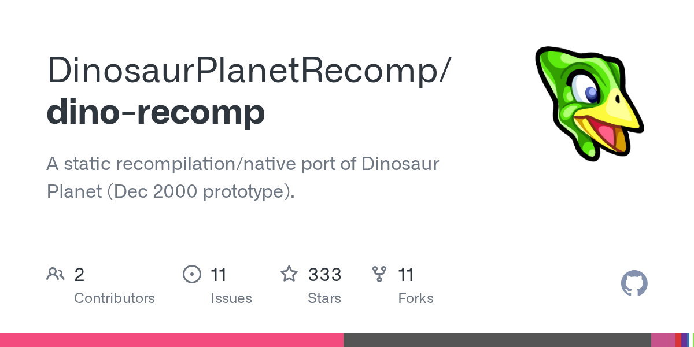</a></td><td><a href="https://github.com/DinosaurPlanetRecomp/dino-recomp"><b>dino-recomp</b></a> DinosaurPlanetRecomp</td><td>N64 프로토타입 Dinosaur Planet을 정적 재컴파일로 네이티브 PC 포트로 만듦.</td><td>아니요</td><td>저장소 카드</td></tr>
<tr><td><a href="https://github.com/bryantmh/rush2recompiled">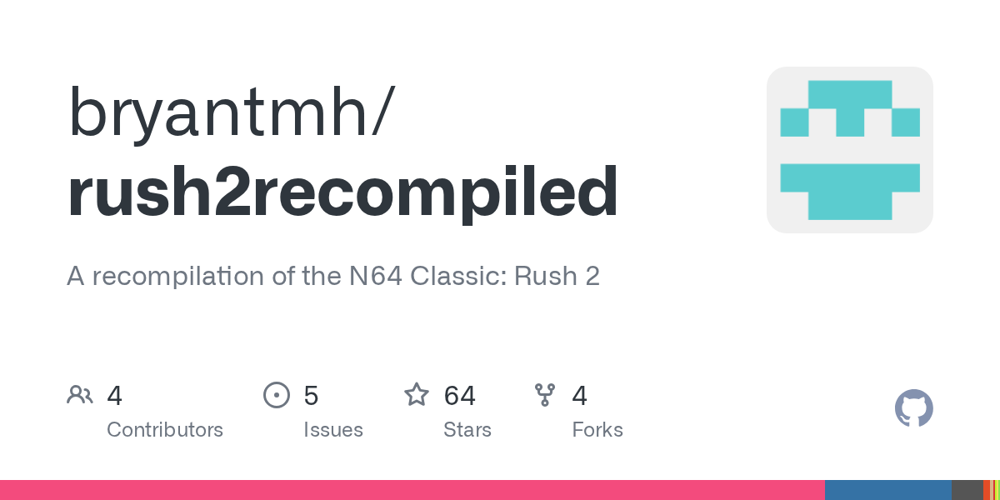</a></td><td><a href="https://github.com/bryantmh/rush2recompiled"><b>rush2recompiled</b></a> bryantmh</td><td>N64의 Rush 2를 미리 번역해서 네이티브 PC에서 실행하는 프로젝트.</td><td>아니요</td><td>저장소 카드</td></tr>
</table>

#### 리메이크 / 포팅

<table>
<tr><th width="170">이미지</th><th>프로젝트</th><th>소개</th><th>rea 사용</th><th>이미지 출처</th></tr>
<tr><td></td><td><a href="https://github.com/Zelda64Recomp/Zelda64Recomp"><b>Zelda64Recomp</b></a> Zelda64Recomp</td><td>무쥬라의 가면을 PC로 리컴파일, 현대식 조작 지원(ROM 직접 준비)</td><td>아니요</td><td>프로젝트 README</td></tr>
<tr><td></td><td><a href="https://github.com/HarbourMasters/Shipwright"><b>Shipwright</b></a> HarbourMasters</td><td>젤다의 전설 시간의 오카리나를 PC에서 네이티브로(ROM 직접 준비)</td><td>아니요</td><td><a href="https://upload.wikimedia.org/wikipedia/en/5/57/The_Legend_of_Zelda_Ocarina_of_Time.jpg">위키백과(© 권리자)</a></td></tr>
<tr><td></td><td><a href="https://github.com/2ship2harkinian/2ship2harkinian"><b>2ship2harkinian</b></a> 2ship2harkinian</td><td>무쥬라의 가면을 PC에서 네이티브로(ROM 직접 준비)</td><td>아니요</td><td><a href="https://upload.wikimedia.org/wikipedia/en/6/60/The_Legend_of_Zelda_-_Majora%27s_Mask_Box_Art.jpg">위키백과(© 권리자)</a></td></tr>
</table>

#### 에셋 추출 및 도구

<table>
<tr><th width="170">이미지</th><th>프로젝트</th><th>소개</th><th>rea 사용</th><th>이미지 출처</th></tr>
<tr><td></td><td><a href="https://github.com/ethteck/splat"><b>splat</b></a> ethteck</td><td>N64·PS1 바이너리를 디컴파일용 프로젝트로 분할</td><td>아니요</td><td>저장소 카드</td></tr>
<tr><td></td><td><a href="https://github.com/NEstelami/ZAPD"><b>ZAPD</b></a> NEstelami</td><td>젤다 64 에셋을 편집 가능한 소스로 변환</td><td>아니요</td><td>프로젝트 README</td></tr>
</table>

### 게임큐브

#### 디컴파일 / 리컴파일

<table>
<tr><th width="170">이미지</th><th>프로젝트</th><th>소개</th><th>rea 사용</th><th>이미지 출처</th></tr>
<tr><td></td><td><a href="https://github.com/doldecomp/melee"><b>melee</b></a> doldecomp</td><td>대난투 스매시브라더스 DX를 C로 디컴파일</td><td>아니요</td><td><a href="https://upload.wikimedia.org/wikipedia/en/7/75/Super_Smash_Bros_Melee_box_art.png">위키백과(© 권리자)</a></td></tr>
<tr><td></td><td><a href="https://github.com/zeldaret/tp"><b>tp</b></a> zeldaret</td><td>젤다의 전설 황혼의 공주를 C++로 디컴파일</td><td>아니요</td><td><a href="https://upload.wikimedia.org/wikipedia/en/0/0e/The_Legend_of_Zelda_Twilight_Princess_Game_Cover.jpg">위키백과(© 권리자)</a></td></tr>
<tr><td></td><td><a href="https://github.com/zeldaret/tww"><b>tww</b></a> zeldaret</td><td>젤다의 전설 바람의 지휘봉을 C로 디컴파일</td><td>아니요</td><td><a href="https://upload.wikimedia.org/wikipedia/en/7/79/The_Legend_of_Zelda_The_Wind_Waker.jpg">위키백과(© 권리자)</a></td></tr>
<tr><td></td><td><a href="https://github.com/projectPiki/pikmin2"><b>pikmin2</b></a> projectPiki</td><td>피크민 2를 C++로 디컴파일</td><td>아니요</td><td><a href="https://upload.wikimedia.org/wikipedia/en/3/38/Pikmin_2_Case.jpg">위키백과(© 권리자)</a></td></tr>
<tr><td></td><td><a href="https://github.com/doldecomp/sms"><b>sms</b></a> doldecomp</td><td>슈퍼 마리오 선샤인을 C++로 디컴파일</td><td>아니요</td><td><a href="https://upload.wikimedia.org/wikipedia/en/0/05/Super_Mario_Sunshine_Box_Art.png">위키백과(© 권리자)</a></td></tr>
</table>

#### 리메이크 / 포팅

<table>
<tr><th width="170">이미지</th><th>프로젝트</th><th>소개</th><th>rea 사용</th><th>이미지 출처</th></tr>
<tr><td><a href="https://github.com/Hero88go/melee-unlocked">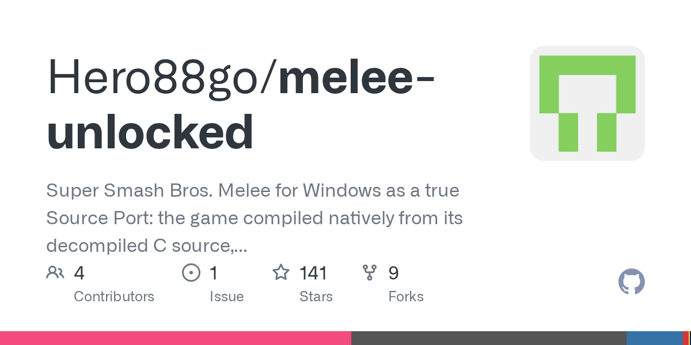</a></td><td><a href="https://github.com/Hero88go/melee-unlocked"><b>melee-unlocked</b></a> Hero88go</td><td>Super Smash Bros. Melee의 디컴파일 소스로 네이티브 Windows 빌드를 만들고 프레임 레이트를 해제.</td><td>아니요</td><td>저장소 카드</td></tr>
</table>

#### 에셋 추출 및 도구

<table>
<tr><th width="170">이미지</th><th>프로젝트</th><th>소개</th><th>rea 사용</th><th>이미지 출처</th></tr>
<tr><td></td><td><a href="https://github.com/encounter/objdiff"><b>objdiff</b></a> encounter</td><td>디컴파일한 함수가 어디서 다른지 한눈에</td><td>아니요</td><td>프로젝트 README</td></tr>
<tr><td></td><td><a href="https://github.com/encounter/decomp-toolkit"><b>decomp-toolkit</b></a> encounter</td><td>수많은 GameCube·Wii 디컴파일을 받치는 툴킷</td><td>아니요</td><td>저장소 카드</td></tr>
</table>

### Wii

#### 디컴파일 / 리컴파일

<table>
<tr><th width="170">이미지</th><th>프로젝트</th><th>소개</th><th>rea 사용</th><th>이미지 출처</th></tr>
<tr><td></td><td><a href="https://github.com/zeldaret/ss"><b>ss</b></a> zeldaret</td><td>젤다의 전설 스카이워드 소드를 C로 디컴파일</td><td>아니요</td><td><a href="https://upload.wikimedia.org/wikipedia/en/9/99/Legend_of_Zelda_Skyward_Sword_boxart.png">위키백과(© 권리자)</a></td></tr>
<tr><td></td><td><a href="https://github.com/DarkRTA/rb3"><b>rb3</b></a> DarkRTA</td><td>록 밴드 3(Wii)를 C++로 디컴파일</td><td>아니요</td><td><a href="https://upload.wikimedia.org/wikipedia/en/3/3b/Rock_Band_3_Game_Cover.jpg">위키백과(© 권리자)</a></td></tr>
</table>

### 닌텐도 DS

#### 디컴파일 / 리컴파일

<table>
<tr><th width="170">이미지</th><th>프로젝트</th><th>소개</th><th>rea 사용</th><th>이미지 출처</th></tr>
<tr><td></td><td><a href="https://github.com/pret/pokeheartgold"><b>pokeheartgold</b></a> pret</td><td>포켓몬스터 하트골드·소울실버를 C로 디컴파일</td><td>아니요</td><td><a href="https://upload.wikimedia.org/wikipedia/en/c/cb/PokemonHGSSBox.jpg">위키백과(© 권리자)</a></td></tr>
<tr><td></td><td><a href="https://github.com/pret/pokeplatinum"><b>pokeplatinum</b></a> pret</td><td>포켓몬스터 Pt C 소스</td><td>아니요</td><td>메인테이너 게시물</td></tr>
<tr><td><a href="https://github.com/tangosdev/sm64ds-decomp">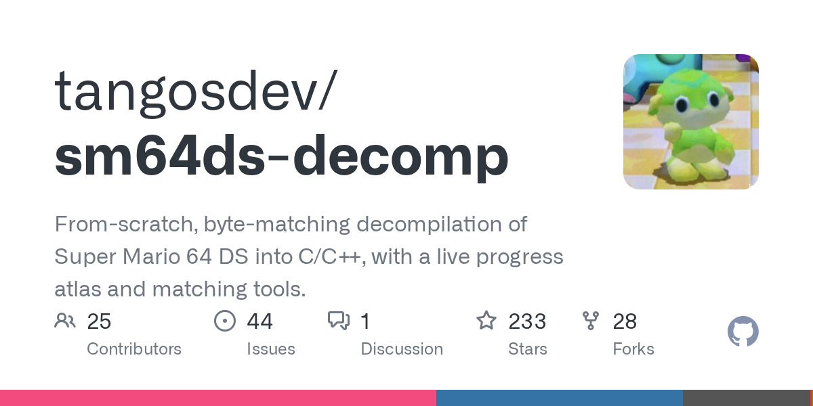</a></td><td><a href="https://github.com/tangosdev/sm64ds-decomp"><b>sm64ds-decomp</b></a> tangosdev</td><td>《슈퍼 마리오 64 DS》를 처음부터 바이트 단위로 일치시키는 디컴파일 프로젝트. 원본 DS 게임을 읽을 수 있는 C/C++ 소스코드로 복원.</td><td>아니요</td><td>저장소 카드</td></tr>
<tr><td></td><td><a href="https://github.com/zeldaret/ph"><b>ph</b></a> zeldaret</td><td>젤다의 전설 몽환의 모래시계를 C로 디컴파일</td><td>아니요</td><td><a href="https://upload.wikimedia.org/wikipedia/en/5/5e/The_Legend_of_Zelda_Phantom_Hourglass_Game_Cover.jpg">위키백과(© 권리자)</a></td></tr>
</table>

### 닌텐도 3DS

#### 에셋 추출 및 도구

<table>
<tr><th width="170">이미지</th><th>프로젝트</th><th>소개</th><th>rea 사용</th><th>이미지 출처</th></tr>
<tr><td></td><td><a href="https://github.com/3DSGuy/Project_CTR"><b>Project_CTR</b></a> 3DSGuy</td><td>3DS 파일 형식 생성·분석(ctrtool / makerom)</td><td>아니요</td><td>저장소 카드</td></tr>
</table>

### PlayStation

#### 디컴파일 / 리컴파일

<table>
<tr><th width="170">이미지</th><th>프로젝트</th><th>소개</th><th>rea 사용</th><th>이미지 출처</th></tr>
<tr><td></td><td><a href="https://github.com/Xeeynamo/sotn-decomp"><b>sotn-decomp</b></a> Xeeynamo</td><td>악마성 드라큘라 X 월하의 야상곡을 C로 디컴파일</td><td>아니요</td><td>메인테이너 게시물</td></tr>
<tr><td></td><td><a href="https://github.com/shdecompilations/silent-hill-decomp"><b>silent-hill-decomp</b></a> shdecompilations</td><td>사일런트 힐(PS1) C 디컴파일 진행 중</td><td>아니요</td><td><a href="https://upload.wikimedia.org/wikipedia/en/9/96/Silent_Hill_video_game_cover.png">위키백과(© 권리자)</a></td></tr>
<tr><td><a href="https://github.com/SlickAmogus/silent-hill-decomp">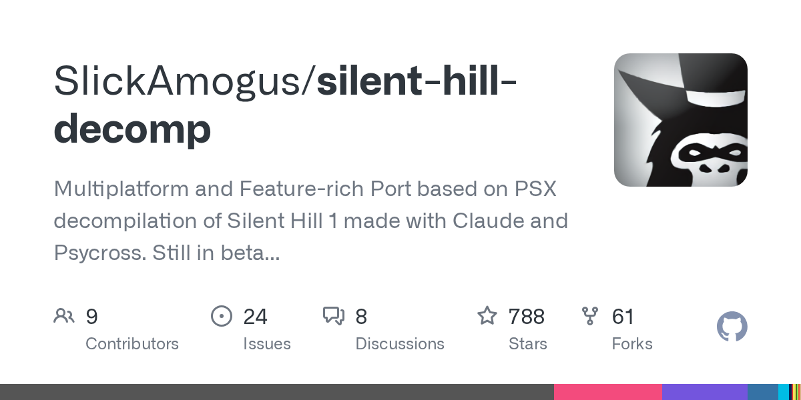</a></td><td><a href="https://github.com/SlickAmogus/silent-hill-decomp"><b>silent-hill-decomp</b></a> SlickAmogus</td><td>원본 《사일런트 힐 1》 PS1 버전을 역컴파일해서 만든, 현대 PC에서 플레이할 수 있는 오픈소스 이식판.</td><td>아니요</td><td>저장소 카드</td></tr>
</table>

### PlayStation 2

#### 디컴파일 / 리컴파일

<table>
<tr><th width="170">이미지</th><th>프로젝트</th><th>소개</th><th>rea 사용</th><th>이미지 출처</th></tr>
<tr><td></td><td><a href="https://github.com/ran-j/PS2Recomp"><b>PS2Recomp</b></a> ran-j</td><td>PS2 게임을 네이티브 PC 실행 파일로 리컴파일</td><td>아니요</td><td>저장소 카드</td></tr>
<tr><td></td><td><a href="https://github.com/open-goal/jak-project"><b>jak-project</b></a> open-goal</td><td>잭 앤 덱스터를 PC에서 네이티브로(디스크 직접 준비)</td><td>아니요</td><td>프로젝트 README</td></tr>
<tr><td><a href="https://github.com/TheRealestNwah/sotc-decomp">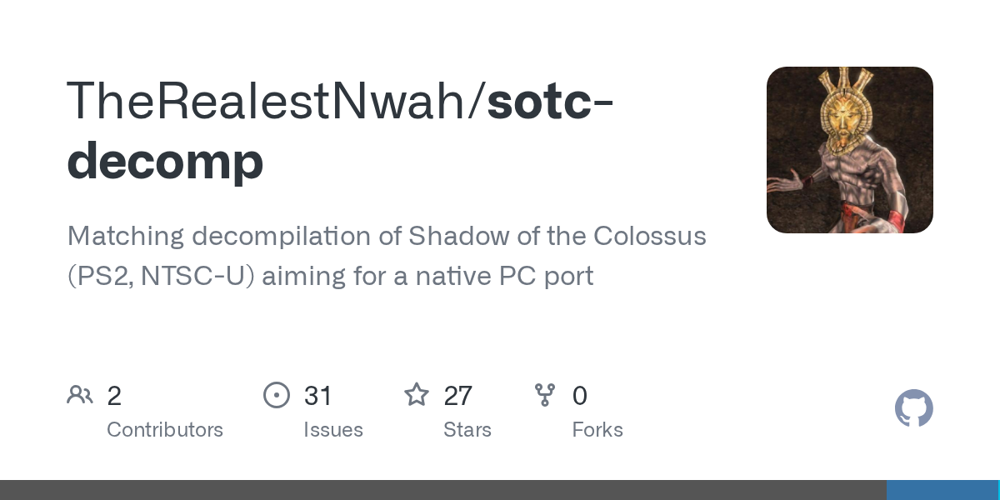</a></td><td><a href="https://github.com/TheRealestNwah/sotc-decomp"><b>sotc-decomp</b></a> TheRealestNwah</td><td>《왕다와 거상》(PS2) 매칭 디컴파일 프로젝트. 원본 게임 코드를 복원해 네이티브 PC 포트를 목표로 함.</td><td>아니요</td><td>저장소 카드</td></tr>
</table>

#### 리메이크 / 포팅

<table>
<tr><th width="170">이미지</th><th>프로젝트</th><th>소개</th><th>rea 사용</th><th>이미지 출처</th></tr>
<tr><td>—</td><td><a href="https://github.com/gothamor/gta-vcs-recomp"><b>gta-vcs-recomp</b></a> gothamor</td><td>원본 PS2 게임 그랜드 테프트 오토: 바이스 시티 스토리즈의 실행 파일을 재컴파일하여 네이티브 Windows 및 Linux 버전을 만듭니다. 디스크 이미지는 직접 준비하세요.</td><td>아니요</td><td>—</td></tr>
<tr><td><a href="https://github.com/thiagordsfx/urban-reign-recomp">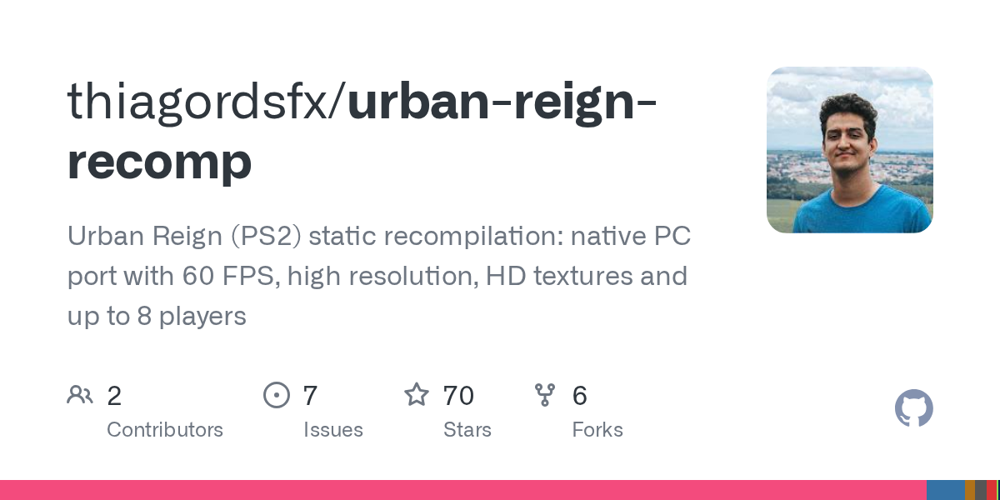</a></td><td><a href="https://github.com/thiagordsfx/urban-reign-recomp"><b>urban-reign-recomp</b></a> thiagordsfx</td><td>PS2 격투 게임 《어반 레인》을 정적 리컴파일로 네이티브 PC 포트로 제작. 60FPS, 고해상도, HD 텍스처 지원.</td><td>아니요</td><td>저장소 카드</td></tr>
</table>

### Xbox / Xbox 360

#### 디컴파일 / 리컴파일

<table>
<tr><th width="170">이미지</th><th>프로젝트</th><th>소개</th><th>rea 사용</th><th>이미지 출처</th></tr>
<tr><td></td><td><a href="https://github.com/hedge-dev/XenonRecomp"><b>XenonRecomp</b></a> hedge-dev</td><td>Xbox 360 게임을 네이티브 C++로 리컴파일</td><td>아니요</td><td>저장소 카드</td></tr>
</table>

#### 리메이크 / 포팅

<table>
<tr><th width="170">이미지</th><th>프로젝트</th><th>소개</th><th>rea 사용</th><th>이미지 출처</th></tr>
<tr><td></td><td><a href="https://github.com/hedge-dev/UnleashedRecomp"><b>UnleashedRecomp</b></a> hedge-dev</td><td>소닉 언리시드를 PC에서 네이티브로(게임 직접 준비)</td><td>아니요</td><td><a href="https://upload.wikimedia.org/wikipedia/en/a/a0/Sonic_unleashed_boxart.jpg">위키백과(© 권리자)</a></td></tr>
<tr><td>—</td><td><a href="https://github.com/MysteriousAeon/rayman3-hd-recompiled"><b>rayman3-hd-recompiled</b></a> MysteriousAeon</td><td>폐쇄 소스 Xbox 360 『레이맨 3 HD』를 정적 재컴파일로 Windows에서 네이티브로 실행되게 만든 것. 자신의 게임 패키지가 필요함.</td><td>아니요</td><td>—</td></tr>
</table>

#### 에셋 추출 및 도구

<table>
<tr><th width="170">이미지</th><th>프로젝트</th><th>소개</th><th>rea 사용</th><th>이미지 출처</th></tr>
<tr><td></td><td><a href="https://github.com/xemu-project/xemu"><b>xemu</b></a> xemu-project</td><td>초대 Xbox 게임을 Windows·macOS·Linux에서</td><td>아니요</td><td>메인테이너 게시물</td></tr>
</table>

### PC / DOS / PC-98

#### 디컴파일 / 리컴파일

<table>
<tr><th width="170">이미지</th><th>프로젝트</th><th>소개</th><th>rea 사용</th><th>이미지 출처</th></tr>
<tr><td></td><td><a href="https://github.com/diasurgical/DevilutionX"><b>DevilutionX</b></a> diasurgical</td><td>디아블로를 최신 OS에서(보유한 DIABDAT.MPQ 사용)</td><td>아니요</td><td>프로젝트 README</td></tr>
<tr><td></td><td><a href="https://github.com/isledecomp/isle"><b>isle</b></a> isledecomp</td><td>레고 아일랜드(1997)를 C++로 디컴파일</td><td>아니요</td><td><a href="https://upload.wikimedia.org/wikipedia/en/a/a1/Lego-island.jpg">위키백과(© 권리자)</a></td></tr>
<tr><td><a href="https://github.com/openblack/bw1-decomp">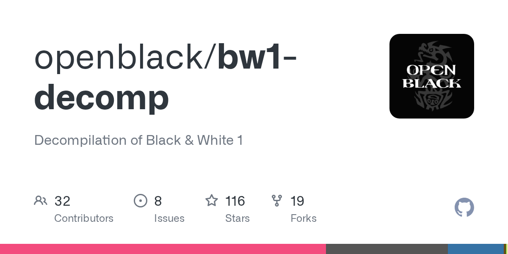</a></td><td><a href="https://github.com/openblack/bw1-decomp"><b>bw1-decomp</b></a> openblack</td><td>클래식 PC 신 게임 《블랙 앤 화이트 1》의 디컴파일 프로젝트. 원본 클로즈드 소스 코드를 오픈소스로 재구성.</td><td>아니요</td><td>저장소 카드</td></tr>
<tr><td></td><td><a href="https://github.com/N0zoM1z0/dx-ball"><b>dx-ball</b></a> N0zoM1z0</td><td>DX-Ball 1.07을 C/C++로 재구성하고 원본 x86과 대조 테스트</td><td>✅ 예</td><td>프로젝트 README</td></tr>
<tr><td></td><td><a href="https://github.com/N0zoM1z0/th08"><b>th08</b></a> N0zoM1z0</td><td>동방영야초를 소스 코드로 재구성</td><td>❔ 미확인</td><td>프로젝트 README</td></tr>
<tr><td></td><td><a href="https://github.com/N0zoM1z0/th04"><b>th04</b></a> N0zoM1z0</td><td>동방환상향(PC-98)을 읽을 수 있는 소스로, 원래 컴파일러로 검증</td><td>✅ 예</td><td>프로젝트 README</td></tr>
<tr><td></td><td><a href="https://github.com/N0zoM1z0/th105"><b>th105</b></a> N0zoM1z0</td><td>동방비상천을 소스 코드로 재구성</td><td>❔ 미확인</td><td>프로젝트 README</td></tr>
<tr><td></td><td><a href="https://github.com/N0zoM1z0/th095"><b>th095</b></a> N0zoM1z0</td><td>동방문화첩을 소스 코드로 재구성</td><td>❔ 미확인</td><td>프로젝트 README</td></tr>
<tr><td></td><td><a href="https://github.com/N0zoM1z0/th10"><b>th10</b></a> N0zoM1z0</td><td>동방풍신록을 소스 코드로 재구성</td><td>❔ 미확인</td><td>프로젝트 README</td></tr>
<tr><td></td><td><a href="https://github.com/N0zoM1z0/th09"><b>th09</b></a> N0zoM1z0</td><td>동방화영총을 소스 코드로 재구성</td><td>❔ 미확인</td><td>프로젝트 README</td></tr>
<tr><td></td><td><a href="https://github.com/N0zoM1z0/touhou-reverse-engineering"><b>touhou-reverse-engineering</b></a> N0zoM1z0</td><td>증거 중심 동방 IDA 노트, 런타임 패치 실험 포함</td><td>아니요</td><td>저장소 카드</td></tr>
<tr><td>—</td><td><a href="https://github.com/yamahuser/mhfz-decomp"><b>mhfz-decomp</b></a> yamahuser</td><td>몬스터 헌터 프론티어 Z 온라인 클라이언트의 리버스 엔지니어링: 함수 이름, 사양 및 보조 도구. 캡콤 원본 코드는 포함되지 않습니다.</td><td>아니요</td><td>—</td></tr>
</table>

#### 리메이크 / 포팅

<table>
<tr><th width="170">이미지</th><th>프로젝트</th><th>소개</th><th>rea 사용</th><th>이미지 출처</th></tr>
<tr><td></td><td><a href="https://github.com/OpenRA/OpenRA"><b>OpenRA</b></a> OpenRA</td><td>고전 커맨드 앤 컨커를 현대 온라인 대전용으로 재구축</td><td>아니요</td><td>프로젝트 README</td></tr>
<tr><td></td><td><a href="https://github.com/OpenRCT2/OpenRCT2"><b>OpenRCT2</b></a> OpenRCT2</td><td>롤러코스터 타이쿤 2를 오픈소스로 최신 OS에서</td><td>아니요</td><td>프로젝트 README</td></tr>
<tr><td></td><td><a href="https://github.com/OpenTTD/OpenTTD"><b>OpenTTD</b></a> OpenTTD</td><td>트랜스포트 타이쿤 디럭스를 오픈소스로, 지금도 발전 중</td><td>아니요</td><td><a href="https://upload.wikimedia.org/wikipedia/commons/b/ba/OpenTTD-15.3-en.png">위키백과(© 권리자)</a></td></tr>
<tr><td></td><td><a href="https://github.com/OpenMW/openmw"><b>openmw</b></a> OpenMW</td><td>모로윈드를 현대적인 오픈소스 엔진으로 플레이</td><td>아니요</td><td><a href="https://upload.wikimedia.org/wikipedia/commons/9/9e/OpenMW_with_example_suit_2.png">위키백과(© 권리자)</a></td></tr>
<tr><td></td><td><a href="https://github.com/Interkarma/daggerfall-unity"><b>daggerfall-unity</b></a> Interkarma</td><td>대거폴을 Unity로 재현(보유한 게임 데이터 사용)</td><td>아니요</td><td>프로젝트 README</td></tr>
<tr><td></td><td><a href="https://github.com/scummvm/scummvm"><b>scummvm</b></a> scummvm</td><td>고전 포인트 앤 클릭 어드벤처를 거의 모든 기기에서</td><td>아니요</td><td>프로젝트 README</td></tr>
<tr><td></td><td><a href="https://github.com/OpenXcom/OpenXcom"><b>OpenXcom</b></a> OpenXcom</td><td>초대 UFO / X-COM을 현대 오픈소스 엔진으로</td><td>아니요</td><td>저장소 카드</td></tr>
<tr><td></td><td><a href="https://github.com/perfect-dark-pc-port/perfect_dark"><b>perfect_dark</b></a> perfect-dark-pc-port</td><td>퍼펙트 다크를 PC에서 네이티브로(ROM 직접 준비)</td><td>아니요</td><td><a href="https://upload.wikimedia.org/wikipedia/en/3/32/Perfect_dark_box.jpg">위키백과(© 권리자)</a></td></tr>
<tr><td><a href="https://github.com/valentderah/totk-pc-recomp">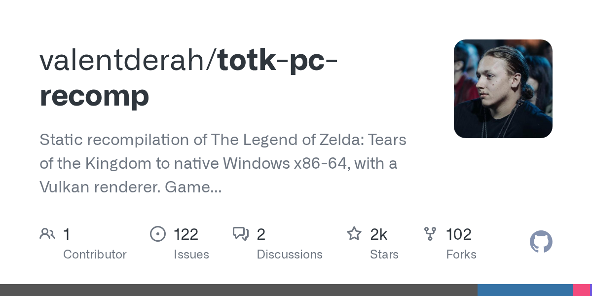</a></td><td><a href="https://github.com/valentderah/totk-pc-recomp"><b>totk-pc-recomp</b></a> valentderah</td><td>닌텐도 스위치 버전의 젤다의 전설: 티어즈 오브 더 킹덤을 에뮬레이터 없이 실행되는 네이티브 Windows 프로그램으로 정적 재컴파일합니다. 게임 파일은 직접 준비해야 합니다.</td><td>아니요</td><td>저장소 카드</td></tr>
<tr><td></td><td><a href="https://github.com/julianxhokaxhiu/FFNx"><b>FFNx</b></a> julianxhokaxhiu</td><td>PC판 FF7/FF8용 최신 드라이버 겸 모드 플랫폼</td><td>아니요</td><td>프로젝트 README</td></tr>
<tr><td>—</td><td><a href="https://github.com/smm2recomp/smm2recomp"><b>smm2recomp</b></a> smm2recomp</td><td>폐쇄 소스 Switch 『슈퍼 마리오 메이커 2』를 정적 재컴파일로 PC·Mac·Linux 등에서 네이티브로 실행되게 만든 것. 자신의 덤프가 필요함.</td><td>아니요</td><td>—</td></tr>
<tr><td></td><td><a href="https://github.com/fallout2-ce/fallout2-ce"><b>fallout2-ce</b></a> fallout2-ce</td><td>폴아웃 2를 최신 OS에서(보유한 게임 데이터 사용)</td><td>아니요</td><td>프로젝트 README</td></tr>
<tr><td><a href="https://github.com/tmcleroy/cps2recomp">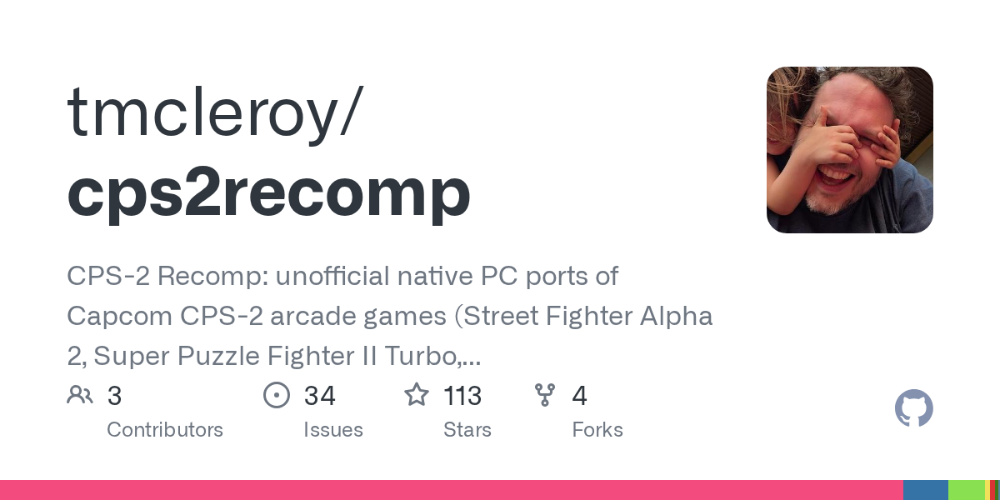</a></td><td><a href="https://github.com/tmcleroy/cps2recomp"><b>cps2recomp</b></a> tmcleroy</td><td>캡콤 CPS-2 아케이드 게임(스트리트 파이터 알파 2 등)을 정적 리컴파일로 만든 비공식 네이티브 PC 포트. ROM은 직접 준비.</td><td>아니요</td><td>저장소 카드</td></tr>
<tr><td></td><td><a href="https://github.com/Moxnatiy/OpenBattlefield2"><b>OpenBattlefield2</b></a> Moxnatiy</td><td>배틀필드 2 엔진을 C++20으로 클린룸 재구현(보유한 게임 사용)</td><td>✅ 예</td><td>프로젝트 README</td></tr>
<tr><td></td><td><a href="https://github.com/N0zoM1z0/th08-web"><b>th08-web</b></a> N0zoM1z0</td><td>th08 재구성을 바탕으로 브라우저에서 즐기는 영야초</td><td>❔ 미확인</td><td>프로젝트 README</td></tr>
<tr><td></td><td><a href="https://github.com/AsyncFinn/rook"><b>rook</b></a> AsyncFinn</td><td>Studio와 대조해 테스트하는 Rust 기반 Roblox 호환 엔진</td><td>아니요</td><td>저장소 카드</td></tr>
<tr><td></td><td><a href="https://github.com/ucodia/desktop-games-nostalgia"><b>desktop-games-nostalgia</b></a> ucodia</td><td>다시 데스크톱 부수기: Gemtree의 2000년작을 macOS와 웹으로</td><td>✅ 예</td><td>프로젝트 README</td></tr>
<tr><td></td><td><a href="https://github.com/tallowmere/free-heroes4"><b>free-heroes4</b></a> tallowmere</td><td>히어로즈 오브 마이트 앤 매직 IV를 C++23 새 엔진으로(GOG 파일 사용)</td><td>아니요</td><td><a href="https://upload.wikimedia.org/wikipedia/en/c/cc/Heroes_of_Might_and_Magic_IV_box.jpg">위키백과(© 권리자)</a></td></tr>
<tr><td>—</td><td><a href="https://github.com/cheviman/outrunners-port"><b>outrunners-port</b></a> cheviman</td><td>1992년 세가 아케이드 게임 OutRunners를 일치하는 C 디컴파일을 기반으로 PC와 콘솔용 네이티브 포트로 만듭니다. ROM은 직접 준비하세요.</td><td>아니요</td><td>—</td></tr>
<tr><td></td><td><a href="https://github.com/tuunanet/rea-ski-or-die-reconstruction"><b>rea-ski-or-die-reconstruction</b></a> tuunanet</td><td>Ski or Die 눈싸움을 Rust + SDL2로 재구현(에셋은 직접 준비)</td><td>✅ 예</td><td>프로젝트 README</td></tr>
<tr><td></td><td><a href="https://github.com/OpenRsG/GunZRs"><b>GunZRs</b></a> OpenRsG</td><td>GunZ: The Duel을 Rust + Bevy로 부활</td><td>✅ 예</td><td>프로젝트 README</td></tr>
<tr><td></td><td><a href="https://github.com/a-barzanti/ai-rebuilds"><b>ai-rebuilds</b></a> a-barzanti</td><td>버려진 게임을 브라우저로 되살림, 원본 파일 미포함</td><td>✅ 예</td><td>저장소 카드</td></tr>
<tr><td>—</td><td><a href="https://github.com/carlhako/keen-clone"><b>keen-clone</b></a> carlhako</td><td>REA + Ghidra로 함수 단위 복원한 Commander Keen 1의 네이티브 Linux/SDL2 재구현</td><td>✅ 예</td><td>—</td></tr>
<tr><td>—</td><td><a href="https://github.com/NathanKanaeru/samp-client-re"><b>samp-client-re</b></a> NathanKanaeru</td><td>REA/Ghidra로 아키텍처를 복원한 SA-MP 0.3.DL-R1 클린룸 클라이언트 재구현</td><td>✅ 예</td><td>—</td></tr>
<tr><td>—</td><td><a href="https://github.com/openage/openage"><b>openage</b></a> openage</td><td>Age of Empires II 등 RTS의 오픈소스 엔진 재구현</td><td>아니요</td><td>—</td></tr>
</table>

#### 에셋 추출 및 도구

<table>
<tr><th width="170">이미지</th><th>프로젝트</th><th>소개</th><th>rea 사용</th><th>이미지 출처</th></tr>
<tr><td></td><td><a href="https://github.com/Perfare/AssetStudio"><b>AssetStudio</b></a> Perfare</td><td>Unity 게임 에셋 탐색·내보내기</td><td>아니요</td><td>저장소 카드</td></tr>
<tr><td></td><td><a href="https://github.com/AssetRipper/AssetRipper"><b>AssetRipper</b></a> AssetRipper</td><td>Unity 빌드를 편집 가능한 프로젝트로 복원</td><td>아니요</td><td>프로젝트 README</td></tr>
<tr><td></td><td><a href="https://github.com/ata4/disunity"><b>disunity</b></a> ata4</td><td>Unity 에셋 파일을 살펴보는 초기 도구 모음</td><td>아니요</td><td>저장소 카드</td></tr>
<tr><td></td><td><a href="https://github.com/ladislav-zezula/CascLib"><b>CascLib</b></a> ladislav-zezula</td><td>블리자드 CASC 아카이브 읽기</td><td>아니요</td><td>저장소 카드</td></tr>
<tr><td>—</td><td><a href="https://github.com/rodneypantonial/sims3-modernization"><b>sims3-modernization</b></a> rodneypantonial</td><td>최신 PC에서 심즈 3 끊김과 크래시 줄이기</td><td>✅ 예</td><td>—</td></tr>
<tr><td></td><td><a href="https://github.com/N0zoM1z0/touhou-reconstruction-factory"><b>touhou-reconstruction-factory</b></a> N0zoM1z0</td><td>동방 시리즈 재구성을 뒷받침하는 에이전트 파이프라인</td><td>❔ 미확인</td><td>저장소 카드</td></tr>
</table>

## 앱 / Electron / 데스크톱

<table>
<tr><th width="170">이미지</th><th>프로젝트</th><th>소개</th><th>rea 사용</th><th>이미지 출처</th></tr>
<tr><td></td><td><a href="https://github.com/storytold/photocraft"><b>photocraft</b></a> storytold</td><td>Adobe Photoshop 같은 사진 편집기를 처음부터 다시 만든 무료 오픈소스 버전. Rust로 작성했으며 레이어, 마스크, PSD를 지원하지만 Adobe 코드는 전혀 사용하지 않음.</td><td>아니요</td><td>프로젝트 README</td></tr>
<tr><td>—</td><td><a href="https://github.com/storytold/pdfcraft"><b>pdfcraft</b></a> storytold</td><td>순수 Rust 클린룸 PDF 리더/에디터</td><td>아니요</td><td>—</td></tr>
<tr><td>—</td><td><a href="https://github.com/storytold/filmcraft"><b>filmcraft</b></a> storytold</td><td>Adobe Premiere Pro 같은 영상 편집기를 처음부터 만든 무료 오픈소스 버전. Rust로 작성했으며 Adobe 코드는 사용하지 않음.</td><td>아니요</td><td>—</td></tr>
<tr><td>—</td><td><a href="https://github.com/storytold/wordcraft"><b>wordcraft</b></a> storytold</td><td>순수 Rust 클린룸 워드 프로세서</td><td>아니요</td><td>—</td></tr>
<tr><td><a href="https://github.com/storytold/lightcraft">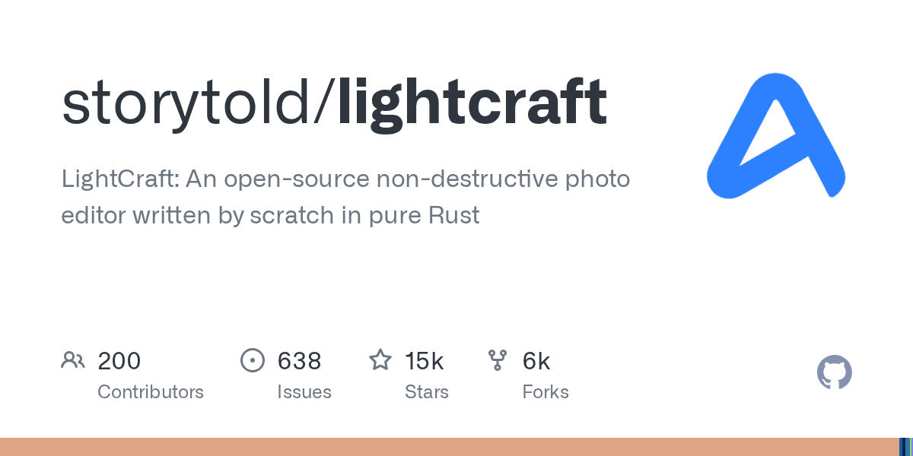</a></td><td><a href="https://github.com/storytold/lightcraft"><b>lightcraft</b></a> storytold</td><td>Adobe Lightroom 같은 사진 관리 및 RAW 현상 도구를 처음부터 다시 만든 오픈소스 버전. 순수 Rust로 작성.</td><td>아니요</td><td>저장소 카드</td></tr>
<tr><td><a href="https://github.com/storytold/vectorcraft">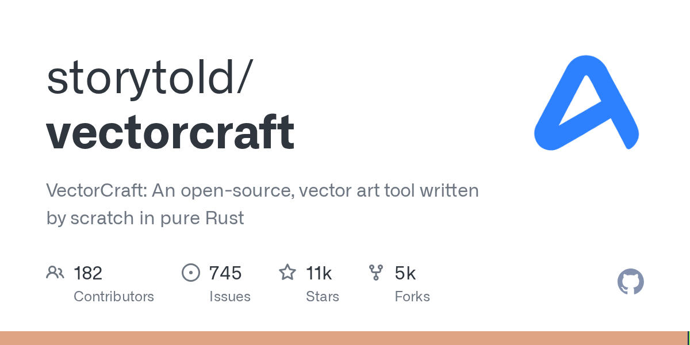</a></td><td><a href="https://github.com/storytold/vectorcraft"><b>vectorcraft</b></a> storytold</td><td>Adobe Illustrator 같은 벡터 그리기 도구를 처음부터 다시 만든 오픈소스 버전. 순수 Rust로 작성했으며 Adobe 코드는 사용하지 않음.</td><td>아니요</td><td>저장소 카드</td></tr>
<tr><td>—</td><td><a href="https://github.com/storytold/effectcraft"><b>effectcraft</b></a> storytold</td><td>Adobe After Effects 같은 모션 그래픽 및 시각 효과 소프트웨어를 처음부터 다시 만든 오픈소스 버전. Rust로 작성.</td><td>아니요</td><td>—</td></tr>
<tr><td>—</td><td><a href="https://github.com/storytold/cadcraft"><b>cadcraft</b></a> storytold</td><td>AutoCAD 같은 CAD 및 제도 프로그램을 처음부터 다시 만든 오픈소스 버전. 순수 Rust로 작성.</td><td>아니요</td><td>—</td></tr>
<tr><td>—</td><td><a href="https://github.com/storytold/gridcraft"><b>gridcraft</b></a> storytold</td><td>Excel 같은 스프레드시트를 처음부터 만든 무료 오픈소스 버전. Rust로 작성.</td><td>아니요</td><td>—</td></tr>
<tr><td>—</td><td><a href="https://github.com/storytold/designcraft"><b>designcraft</b></a> storytold</td><td>Adobe InDesign 같은 페이지 레이아웃 및 출판 에디터를 처음부터 다시 만든 오픈소스 버전. Rust로 작성.</td><td>아니요</td><td>—</td></tr>
<tr><td>—</td><td><a href="https://github.com/storytold/deckcraft"><b>deckcraft</b></a> storytold</td><td>PowerPoint 같은 프레젠테이션 소프트웨어를 처음부터 다시 만든 오픈소스 버전. Rust로 작성.</td><td>아니요</td><td>—</td></tr>
<tr><td>—</td><td><a href="https://github.com/storytold/soundcraft"><b>soundcraft</b></a> storytold</td><td>Pro Tools 같은 디지털 오디오 워크스테이션을 처음부터 다시 만든 오픈소스 버전. Rust로 작성.</td><td>아니요</td><td>—</td></tr>
<tr><td>—</td><td><a href="https://github.com/storytold/figcraft"><b>figcraft</b></a> storytold</td><td>Figma 같은 인터페이스 디자인 및 프로토타이핑 도구를 처음부터 만든 무료 오픈소스 버전. Rust로 작성.</td><td>아니요</td><td>—</td></tr>
<tr><td><a href="https://github.com/electron/asar">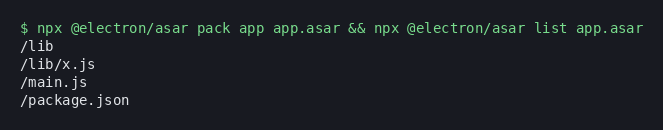</a></td><td><a href="https://github.com/electron/asar"><b>asar</b></a> electron</td><td>Electron 앱 내부 아카이브 패킹·언패킹</td><td>아니요</td><td>자체 스크린샷</td></tr>
<tr><td>—</td><td><a href="https://github.com/Caho1/open-claude-ui"><b>open-claude-ui</b></a> Caho1</td><td>REA로 Claude Desktop UI와 상호작용 물리를 추출한 고충실도 재구현</td><td>✅ 예</td><td>—</td></tr>
<tr><td></td><td><a href="https://github.com/GLinnik21/plx-native"><b>plx-native</b></a> GLinnik21</td><td>LG TV용 더 빠른 네이티브 Plex 클라이언트</td><td>아니요</td><td>프로젝트 README</td></tr>
<tr><td></td><td><a href="https://github.com/michaelshimeles/terminal-rs"><b>terminal-rs</b></a> michaelshimeles</td><td>Rust로 만든 블룸버그 스타일 트레이딩 터미널</td><td>✅ 예</td><td>프로젝트 README</td></tr>
<tr><td></td><td><a href="https://github.com/michaelshimeles/rec-rs"><b>rec-rs</b></a> michaelshimeles</td><td>OBS를 참고한 Rust 기반 빠른 macOS 녹화 도구</td><td>✅ 예</td><td>프로젝트 README</td></tr>
<tr><td>—</td><td><a href="https://github.com/Xiangyu-CAS/rea-capcut"><b>rea-capcut</b></a> Xiangyu-CAS</td><td>REA로 CapCut을 분석해 다시 만든 오픈소스 오프라인 영상 편집기</td><td>✅ 예</td><td>—</td></tr>
<tr><td></td><td><a href="https://github.com/michaelshimeles/sketch"><b>sketch</b></a> michaelshimeles</td><td>Paper를 연구해 만든 Rust 무한 디자인 캔버스</td><td>✅ 예</td><td>프로젝트 README</td></tr>
<tr><td></td><td><a href="https://github.com/lxistired/ledger-reborn"><b>ledger-reborn</b></a> lxistired</td><td>QuickBooks for Mac을 참고한 로컬 우선 회계 앱</td><td>✅ 예</td><td>프로젝트 README</td></tr>
<tr><td>—</td><td><a href="https://github.com/glauberlima/open-scrantic"><b>open-scrantic</b></a> glauberlima</td><td>REA로 역공학한 1992년 Johnny Castaway 화면 보호기의 Rust 재구현</td><td>✅ 예</td><td>—</td></tr>
<tr><td></td><td><a href="https://github.com/LilZeeCN/zee-rp"><b>zee-rp</b></a> LilZeeCN</td><td>CLI나 MCP로 Axure RP 프로토타입 파일 읽기·쓰기</td><td>❔ 미확인</td><td>프로젝트 README</td></tr>
<tr><td></td><td><a href="https://github.com/sickpyramid/ReaFuse"><b>ReaFuse</b></a> sickpyramid</td><td>REA로 두 JS/TS 프로젝트를 하나로 합치기</td><td>✅ 예</td><td>저장소 카드</td></tr>
<tr><td></td><td><a href="https://github.com/laaielichter/Reverseport"><b>Reverseport</b></a> laaielichter</td><td>리버싱 결과를 Godot·Unity·Unreal·three.js로 이식</td><td>❔ 미확인</td><td>프로젝트 README</td></tr>
<tr><td></td><td><a href="https://github.com/iammukeshm/hexgrab"><b>hexgrab</b></a> iammukeshm</td><td>PowerToys 바이너리를 분석해 만든 작은 Windows 색상 선택기</td><td>✅ 예</td><td>저장소 카드</td></tr>
<tr><td></td><td><a href="https://github.com/cudanexus/vd-streamer-linux"><b>vd-streamer-linux</b></a> cudanexus</td><td>Linux 데스크톱을 Quest·Pico 헤드셋으로 스트리밍</td><td>✅ 예</td><td>저장소 카드</td></tr>
<tr><td><a href="https://github.com/monatis/okur">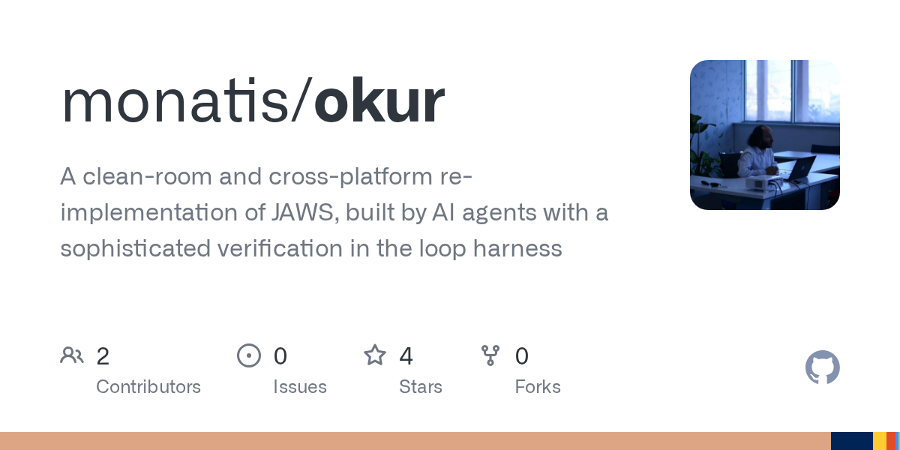</a></td><td><a href="https://github.com/monatis/okur"><b>okur</b></a> monatis</td><td>JAWS처럼 동작하는 오픈소스 스크린 리더. JAWS의 음성을 관찰해 처음부터 다시 구현.</td><td>아니요</td><td>저장소 카드</td></tr>
<tr><td></td><td><a href="https://github.com/az9713/wispr-flow-rea-teardown"><b>wispr-flow-rea-teardown</b></a> az9713</td><td>Wispr Flow 음성 파이프라인 해부와 64줄 재구현</td><td>✅ 예</td><td><a href="https://img.youtube.com/vi/FnB9tHKBJXQ/maxresdefault.jpg">동영상 썸네일</a></td></tr>
<tr><td></td><td><a href="https://github.com/KarlssonChristoffer/DiskLens"><b>DiskLens</b></a> KarlssonChristoffer</td><td>WinDirStat처럼 Windows 11 디스크 사용량을 시각화</td><td>✅ 예</td><td>저장소 카드</td></tr>
<tr><td></td><td><a href="https://github.com/AdamLinCodes/AdamTerm"><b>AdamTerm</b></a> AdamLinCodes</td><td>Ghostty를 살펴보고 만든 미니멀 macOS 터미널</td><td>✅ 예</td><td>프로젝트 README</td></tr>
<tr><td>—</td><td><a href="https://github.com/chilliesdev/fmseasonhub-re"><b>fmseasonhub-re</b></a> chilliesdev</td><td>REA로 FM Season Hub 앱을 분석한 노트</td><td>✅ 예</td><td>—</td></tr>
</table>

## 프로토콜 / 하드웨어

<table>
<tr><th width="170">이미지</th><th>프로젝트</th><th>소개</th><th>rea 사용</th><th>이미지 출처</th></tr>
<tr><td></td><td><a href="https://github.com/mitmproxy/mitmproxy"><b>mitmproxy</b></a> mitmproxy</td><td>HTTPS 트래픽을 실시간으로 보고 수정</td><td>아니요</td><td>프로젝트 README</td></tr>
<tr><td><a href="https://github.com/wireshark/wireshark">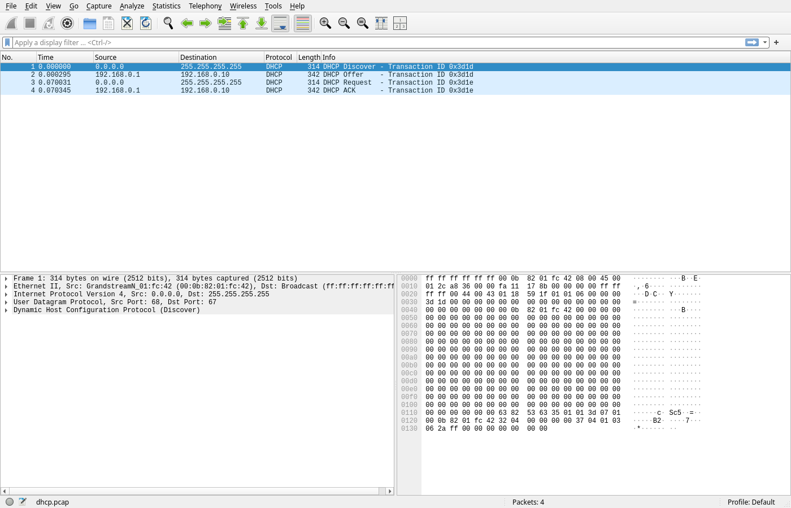</a></td><td><a href="https://github.com/wireshark/wireshark"><b>wireshark</b></a> wireshark</td><td>네트워크의 모든 패킷을 디코딩해 확인</td><td>아니요</td><td>자체 스크린샷</td></tr>
<tr><td></td><td><a href="https://github.com/postlund/pyatv"><b>pyatv</b></a> postlund</td><td>Python으로 Apple TV·AirPlay 기기 제어</td><td>아니요</td><td>저장소 카드</td></tr>
<tr><td></td><td><a href="https://github.com/a-funk/open-appleremote"><b>open-appleremote</b></a> a-funk</td><td>1세대 Siri 리모컨을 Linux에서, 제스처까지 지원</td><td>❔ 미확인</td><td>저장소 카드</td></tr>
<tr><td></td><td><a href="https://github.com/Slyvan25/OpenGHub"><b>OpenGHub</b></a> Slyvan25</td><td>G HUB 없이 Linux에서 로지텍 장치 제어</td><td>아니요</td><td>프로젝트 README</td></tr>
<tr><td>—</td><td><a href="https://github.com/EndLess728/MiTV-Remote"><b>MiTV-Remote</b></a> EndLess728</td><td>Mac·안드로이드·아이폰에서 Wi-Fi로 샤오미 TV 조작</td><td>✅ 예</td><td>—</td></tr>
<tr><td>—</td><td><a href="https://github.com/B-Howell/soundconnect-desktop"><b>soundconnect-desktop</b></a> B-Howell</td><td>Windows 데스크톱에서 소니 블루투스 헤드폰 제어</td><td>✅ 예</td><td>—</td></tr>
</table>

## 펌웨어 / 드라이버

<table>
<tr><th width="170">이미지</th><th>프로젝트</th><th>소개</th><th>rea 사용</th><th>이미지 출처</th></tr>
<tr><td></td><td><a href="https://github.com/ReFirmLabs/binwalk"><b>binwalk</b></a> ReFirmLabs</td><td>펌웨어 이미지 속 내용을 찾아 추출</td><td>아니요</td><td>프로젝트 README</td></tr>
<tr><td></td><td><a href="https://github.com/qilingframework/qiling"><b>qiling</b></a> qilingframework</td><td>여러 OS·CPU의 바이너리를 에뮬레이션·계측</td><td>아니요</td><td>프로젝트 README</td></tr>
<tr><td><a href="https://github.com/onekey-sec/unblob">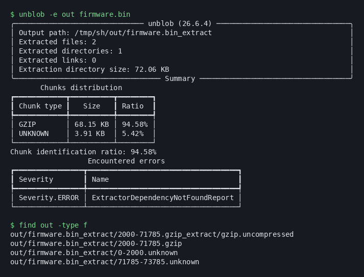</a></td><td><a href="https://github.com/onekey-sec/unblob"><b>unblob</b></a> onekey-sec</td><td>거의 모든 펌웨어·컨테이너 형식을 재귀적으로 추출</td><td>아니요</td><td>자체 스크린샷</td></tr>
<tr><td></td><td><a href="https://github.com/attify/firmware-analysis-toolkit"><b>firmware-analysis-toolkit</b></a> attify</td><td>IoT 펌웨어를 에뮬레이션해 안전하게 분석</td><td>아니요</td><td>저장소 카드</td></tr>
<tr><td></td><td><a href="https://github.com/travisgoodspeed/md380tools"><b>md380tools</b></a> travisgoodspeed</td><td>TYT MD-380 무전기용 커스텀 펌웨어 패치</td><td>아니요</td><td>저장소 카드</td></tr>
<tr><td></td><td><a href="https://github.com/ghidraninja/game-and-watch-backup"><b>game-and-watch-backup</b></a> ghidraninja</td><td>내 Game &amp; Watch 펌웨어 백업·복원</td><td>아니요</td><td><a href="https://img.youtube.com/vi/-MzmoEFs0bQ/maxresdefault.jpg">동영상 썸네일</a></td></tr>
<tr><td>—</td><td><a href="https://github.com/nicolvus/a6000-fw-decomp"><b>a6000-fw-decomp</b></a> nicolvus</td><td>REA와 Ghidra로 소니 A6000 펌웨어 분석</td><td>✅ 예</td><td>—</td></tr>
<tr><td></td><td><a href="https://github.com/grisuno/VSL-DSP"><b>VSL-DSP</b></a> grisuno</td><td>PreSonus AudioBox VSL용 Linux 커널 모듈</td><td>✅ 예</td><td>저장소 카드</td></tr>
</table>

## 보안 / 평가

<table>
<tr><th width="170">이미지</th><th>프로젝트</th><th>소개</th><th>rea 사용</th><th>이미지 출처</th></tr>
<tr><td></td><td><a href="https://github.com/morluto/rea/discussions/2254"><b>REA discussion #2254</b></a></td><td>심볼 없는 bzip2를 분석하고 실제 빌드와 대조</td><td>✅ 예</td><td>자체 스크린샷</td></tr>
<tr><td></td><td><a href="https://github.com/pablodiazjorge/rea-lab"><b>rea-lab</b></a> pablodiazjorge</td><td>Windows + Ghidra 실습과 사전 등록된 REA 평가</td><td>✅ 예</td><td>저장소 카드</td></tr>
<tr><td></td><td><a href="https://github.com/NullLabTests/OpenBSD_netcat_REA"><b>OpenBSD_netcat_REA</b></a> NullLabTests</td><td>REA와 Ghidra로 netcat-openbsd 정적 분석</td><td>✅ 예</td><td>프로젝트 README</td></tr>
<tr><td></td><td><a href="https://github.com/UnknownHacker1/rea-groundtruth"><b>rea-groundtruth</b></a> UnknownHacker1</td><td>REA 보고서를 실제 소스와 대조</td><td>✅ 예</td><td>저장소 카드</td></tr>
<tr><td></td><td><a href="https://github.com/az9713/REA-demo"><b>REA-demo</b></a> az9713</td><td>REA가 스스로를 분석, 반증 가능한 예측 포함</td><td>✅ 예</td><td>저장소 카드</td></tr>
</table>

## 리버싱 도구

<table>
<tr><th width="170">이미지</th><th>프로젝트</th><th>소개</th><th>rea 사용</th><th>이미지 출처</th></tr>
<tr><td><a href="https://github.com/NationalSecurityAgency/ghidra">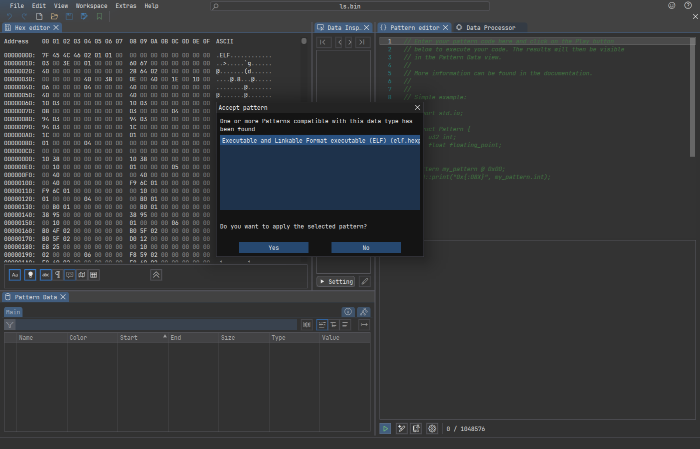</a></td><td><a href="https://github.com/NationalSecurityAgency/ghidra"><b>ghidra</b></a> NationalSecurityAgency</td><td>NSA가 공개한 무료 디컴파일러·디스어셈블러</td><td>아니요</td><td>자체 스크린샷</td></tr>
<tr><td><a href="https://github.com/WerWolv/ImHex">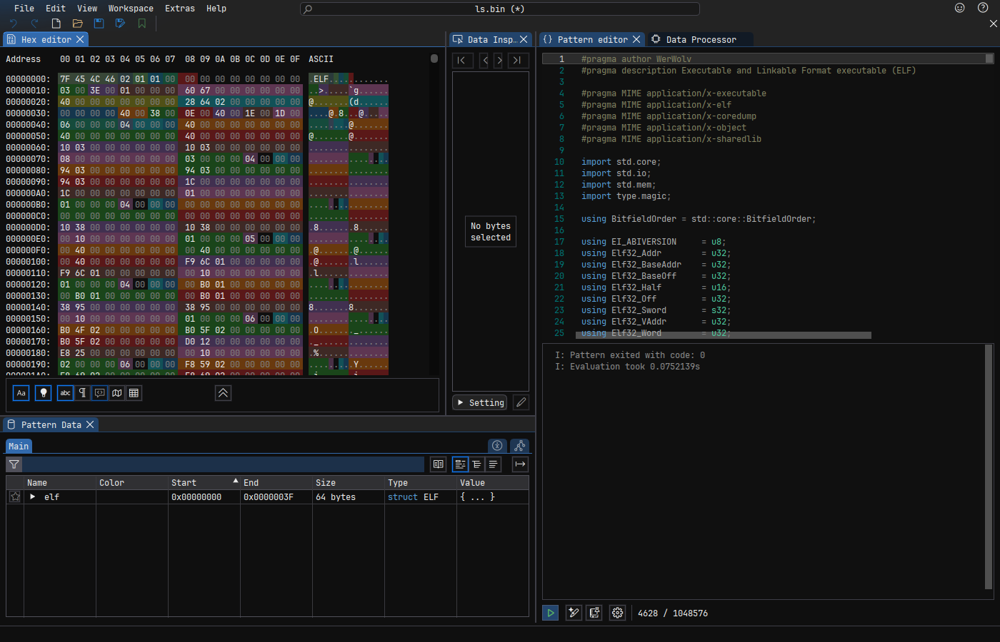</a></td><td><a href="https://github.com/WerWolv/ImHex"><b>ImHex</b></a> WerWolv</td><td>구조를 해석해 주는 패턴 언어가 있는 헥스 에디터</td><td>아니요</td><td>자체 스크린샷</td></tr>
<tr><td></td><td><a href="https://github.com/skylot/jadx"><b>jadx</b></a> skylot</td><td>안드로이드 APK를 읽을 수 있는 Java로 복원</td><td>아니요</td><td>프로젝트 README</td></tr>
<tr><td></td><td><a href="https://github.com/x64dbg/x64dbg"><b>x64dbg</b></a> x64dbg</td><td>Windows 바이너리용 대표 오픈소스 디버거</td><td>아니요</td><td>프로젝트 README</td></tr>
<tr><td></td><td><a href="https://github.com/icsharpcode/ILSpy"><b>ILSpy</b></a> icsharpcode</td><td>어떤 .NET 어셈블리든 C#으로 복원</td><td>아니요</td><td>저장소 카드</td></tr>
<tr><td><a href="https://github.com/iBotPeaches/Apktool">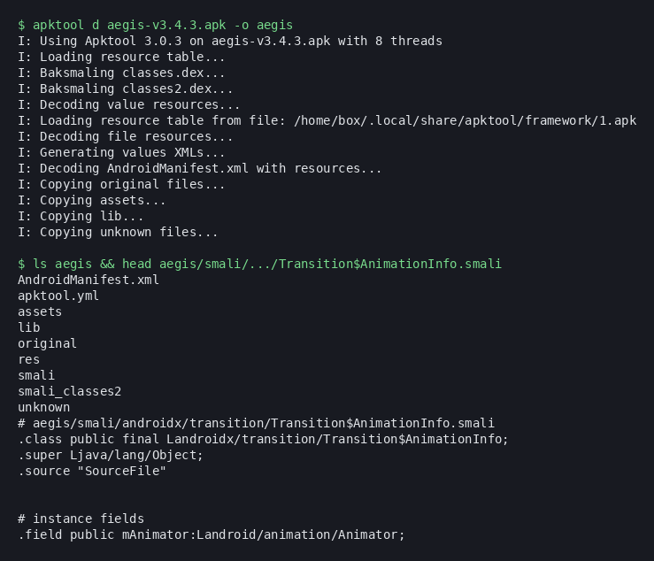</a></td><td><a href="https://github.com/iBotPeaches/Apktool"><b>Apktool</b></a> iBotPeaches</td><td>안드로이드 APK 해체·분석·재빌드</td><td>아니요</td><td>자체 스크린샷</td></tr>
<tr><td></td><td><a href="https://github.com/radareorg/radare2"><b>radare2</b></a> radareorg</td><td>스크립트 가능한 커맨드라인 리버싱 프레임워크</td><td>아니요</td><td>프로젝트 README</td></tr>
<tr><td><a href="https://github.com/frida/frida">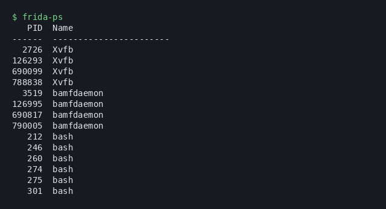</a></td><td><a href="https://github.com/frida/frida"><b>frida</b></a> frida</td><td>실행 중인 앱에 훅을 걸어 실시간으로 동작 변경</td><td>아니요</td><td>자체 스크린샷</td></tr>
<tr><td></td><td><a href="https://github.com/rizinorg/cutter"><b>cutter</b></a> rizinorg</td><td>Rizin 기반의 친숙한 리버싱 GUI</td><td>아니요</td><td>프로젝트 README</td></tr>
<tr><td></td><td><a href="https://github.com/mrexodia/ida-pro-mcp"><b>ida-pro-mcp</b></a> mrexodia</td><td>MCP로 AI 에이전트가 IDA Pro를 조작</td><td>아니요</td><td>프로젝트 README</td></tr>
<tr><td></td><td><a href="https://github.com/LaurieWired/GhidraMCP"><b>GhidraMCP</b></a> LaurieWired</td><td>AI 도우미(Claude 등)가 무료 리버스 엔지니어링 도구 Ghidra를 직접 제어할 수 있게 해주는 브리지. AI가 디컴파일과 함수 이름 변경을 대신 수행.</td><td>아니요</td><td>프로젝트 README</td></tr>
<tr><td></td><td><a href="https://github.com/dnSpyEx/dnSpy"><b>dnSpy</b></a> dnSpyEx</td><td>소스 없이 .NET 어셈블리 디버그·편집</td><td>아니요</td><td>프로젝트 README</td></tr>
<tr><td>—</td><td><a href="https://github.com/wtsxdev/reverse-engineering"><b>reverse-engineering</b></a> wtsxDev</td><td>클래식한 리버스 엔지니어링 자료/도구/학습 목록</td><td>아니요</td><td>—</td></tr>
<tr><td></td><td><a href="https://github.com/angr/angr"><b>angr</b></a> angr</td><td>Python으로 심볼릭 실행과 바이너리 분석</td><td>아니요</td><td>저장소 카드</td></tr>
<tr><td></td><td><a href="https://github.com/avast/retdec"><b>retdec</b></a> avast</td><td>다양한 아키텍처의 기계어를 C로 디컴파일</td><td>아니요</td><td>메인테이너 게시물</td></tr>
<tr><td>—</td><td><a href="https://github.com/albertan017/LLM4Decompile"><b>LLM4Decompile</b></a> albertan017</td><td>LLM 기반 바이너리 디컴파일을 위한 연구 모델과 도구 (오픈 웨이트).</td><td>아니요</td><td>—</td></tr>
<tr><td></td><td><a href="https://github.com/mandiant/capa"><b>capa</b></a> mandiant</td><td>실행 파일이 무엇을 할 수 있는지 ATT&amp;CK 매핑으로 확인</td><td>아니요</td><td>프로젝트 README</td></tr>
<tr><td>—</td><td><a href="https://github.com/alphaSeclab/awesome-reverse-engineering"><b>awesome-reverse-engineering</b></a> alphaSeclab</td><td>주요 플랫폼과 영역을 아우르는 대규모 리버스 엔지니어링 도구/리소스 모음.</td><td>아니요</td><td>—</td></tr>
<tr><td><a href="https://github.com/mandiant/flare-floss">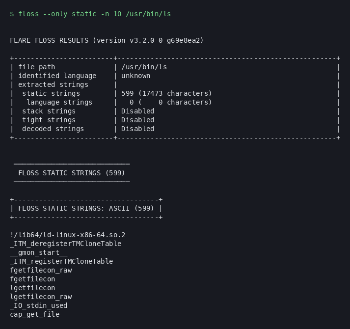</a></td><td><a href="https://github.com/mandiant/flare-floss"><b>flare-floss</b></a> mandiant</td><td>악성코드 속 숨겨진 난독화 문자열을 추출</td><td>아니요</td><td>자체 스크린샷</td></tr>
<tr><td></td><td><a href="https://github.com/rizinorg/rizin"><b>rizin</b></a> rizinorg</td><td>radare2에서 갈라져 나온 UNIX식 리버싱 프레임워크</td><td>아니요</td><td>프로젝트 README</td></tr>
<tr><td>—</td><td><a href="https://github.com/aicodeking/leanrea"><b>leanrea</b></a> aicodeking</td><td>REA MCP 계층을 대체하는 경량 스킬. 에이전트가 CLI 도구를 직접 구동</td><td>✅ 예</td><td>—</td></tr>
<tr><td>—</td><td><a href="https://github.com/JusticeRage/Gepetto"><b>Gepetto</b></a> JusticeRage</td><td>IDA Pro 플러그인. 언어 모델로 함수 설명, 이름 변경, 주석을 지원.</td><td>아니요</td><td>—</td></tr>
<tr><td></td><td><a href="https://github.com/google/bindiff"><b>bindiff</b></a> google</td><td>두 바이너리 버전 사이의 변경점 찾기</td><td>아니요</td><td>프로젝트 README</td></tr>
<tr><td>—</td><td><a href="https://github.com/zinja-coder/jadx-ai-mcp"><b>jadx-ai-mcp</b></a> zinja-coder</td><td>JADX용 MCP 플러그인. AI 에이전트가 Android APK/DEX를 디컴파일하고 탐색 가능.</td><td>아니요</td><td>—</td></tr>
<tr><td>—</td><td><a href="https://github.com/SubmitGame/awesome-decomp-games"><b>awesome-decomp-games</b></a> SubmitGame</td><td>평점 및 자동 갱신되는 게임 decomp/recomp/소스 포트/엔진 리메이크 목록</td><td>아니요</td><td>—</td></tr>
<tr><td>—</td><td><a href="https://github.com/cranebeaker/coop-anything"><b>coop-anything</b></a> cranebeaker</td><td>REA로 진입점을 조사해 싱글 플레이 게임에 협동 모드를 추가하는 MCP 서버</td><td>✅ 예</td><td>—</td></tr>
<tr><td></td><td><a href="https://github.com/HexRaysSA/ida-mcp"><b>ida-mcp</b></a> HexRaysSA</td><td>Hex-Rays 공식 IDA용 MCP 서버</td><td>아니요</td><td>저장소 카드</td></tr>
<tr><td>—</td><td><a href="https://github.com/morluto/awesome-reverse-engineering"><b>awesome-reverse-engineering</b></a> morluto</td><td>RE 도구와 학습 리소스의 엄선된 입문 목록 (바이너리, 앱, 펌웨어, 포맷, 프로토콜). REA 작성자 유지.</td><td>아니요</td><td>—</td></tr>
<tr><td></td><td><a href="https://github.com/ghidraninja/ghidra_scripts"><b>ghidra_scripts</b></a> ghidraninja</td><td>binwalk 연동부터 YARA까지 유용한 Ghidra 스크립트</td><td>아니요</td><td>프로젝트 README</td></tr>
<tr><td>—</td><td><a href="https://github.com/alexgaoth/awesome-reverse-engineered"><b>awesome-reverse-engineered</b></a> alexgaoth</td><td>누군가 클로즈드 앱, 게임, API 또는 장치를 리버스 엔지니어링해서 만든 오픈소스 프로젝트 1.7만 개 이상을 모아 둔 검색 가능한 카탈로그. 자체 검색 사이트와 MCP 서버 포함.</td><td>아니요</td><td>—</td></tr>
<tr><td><a href="https://github.com/cyberkaida/reverse-engineering-assistant">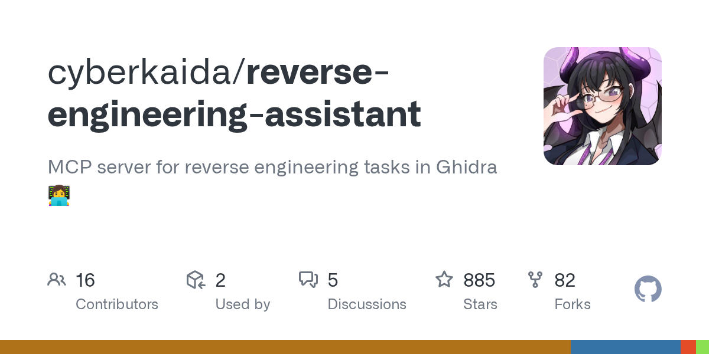</a></td><td><a href="https://github.com/cyberkaida/reverse-engineering-assistant"><b>reverse-engineering-assistant</b></a> cyberkaida</td><td>AI가 Ghidra(NSA의 무료 리버스 엔지니어링 도구)를 제어하는 또 다른 방법. AI에게 작고 집중된 도구를 주어 큰 프로그램도 혼란 없이 분석 가능.</td><td>아니요</td><td>저장소 카드</td></tr>
<tr><td>—</td><td><a href="https://github.com/MiaAI-Lab/sparkDash"><b>sparkDash</b></a> MiaAI-Lab</td><td>장시간 REA 분석 작업을 통합하고 결과를 온디맨드로 로드하는 멀티 디바이스 대시보드</td><td>✅ 예</td><td>—</td></tr>
<tr><td>—</td><td><a href="https://github.com/symgraph/GhidrAssist"><b>GhidrAssist</b></a> symgraph</td><td>Ghidra용 LLM 확장. 디컴파일된 코드의 이름 변경, 설명, 분석을 지원.</td><td>아니요</td><td>—</td></tr>
<tr><td>—</td><td><a href="https://github.com/nforest/awesome-decompilation"><b>awesome-decompilation</b></a> nforest</td><td>디컴파일 관련 리소스, 논문, 중간 표현, 프로젝트의 엄선된 목록.</td><td>아니요</td><td>—</td></tr>
<tr><td></td><td><a href="https://github.com/decompme/decomp.me"><b>decomp.me</b></a> decompme</td><td>브라우저에서 함께 디컴파일하며 일치 빌드에 도전</td><td>아니요</td><td>저장소 카드</td></tr>
<tr><td>—</td><td><a href="https://github.com/radareorg/r2ai"><b>r2ai</b></a> radareorg</td><td>radare2용 LLM 기반 리버스 도구 및 플러그인</td><td>아니요</td><td>—</td></tr>
<tr><td>—</td><td><a href="https://github.com/fosdickio/binary_ninja_mcp"><b>binary_ninja_mcp</b></a> fosdickio</td><td>LLM 에이전트가 Binary Ninja를 구동할 수 있는 MCP 서버 (디컴파일, xref, 이름 변경 등).</td><td>아니요</td><td>—</td></tr>
<tr><td>—</td><td><a href="https://github.com/radareorg/radare2-mcp"><b>radare2-mcp</b></a> radareorg</td><td>radare2 공식 MCP stdio 서버</td><td>아니요</td><td>—</td></tr>
<tr><td></td><td><a href="https://github.com/ShadowSwaps/REA-Reconstruction-Companion"><b>REA-Reconstruction-Companion</b></a> ShadowSwaps</td><td>재구성을 항상 증거와 연결하는 에이전트 스킬</td><td>✅ 예</td><td>저장소 카드</td></tr>
<tr><td></td><td><a href="https://github.com/rizinorg/jsdec"><b>jsdec</b></a> rizinorg</td><td>손으로 쓴 어셈블리도 읽기 쉬운 의사 C로 바꾸는 Rizin용 디컴파일러</td><td>아니요</td><td>저장소 카드</td></tr>
<tr><td>—</td><td><a href="https://github.com/giveen/decomp.anything"><b>decomp.anything</b></a> giveen</td><td>업데이트 중단된 매칭 디컴파일러 decomp.wtf의 활성 포크. Windows/Linux 바이너리 지원과 REA 브리지를 추가해 게임 외 프로그램도 AI가 역공학할 수 있게 함.</td><td>✅ 예</td><td>—</td></tr>
<tr><td></td><td><a href="https://github.com/czcdr/dsh-plugin-rea"><b>dsh-plugin-rea</b></a> czcdr</td><td>DeepSeek Harness에서 REA 사용, Ghidra 자동 설치</td><td>✅ 예</td><td>프로젝트 README</td></tr>
<tr><td></td><td><a href="https://github.com/0xshlomil/ida-free-mcp"><b>ida-free-mcp</b></a> 0xshlomil</td><td>MCP로 AI 에이전트가 IDA Free 사용</td><td>✅ 예</td><td>저장소 카드</td></tr>
<tr><td></td><td><a href="https://github.com/dav1dngy/era-agent"><b>era-agent</b></a> dav1dngy</td><td>증거 기반으로 스스로 개선을 시도하는 리버싱 에이전트</td><td>❔ 미확인</td><td>프로젝트 README</td></tr>
<tr><td>—</td><td><a href="https://github.com/tanepiper/game-frame"><b>game-frame</b></a> tanepiper</td><td>배포 파일로 에이전트가 게임을 역공학하는 프레임워크</td><td>✅ 예</td><td>—</td></tr>
<tr><td></td><td><a href="https://github.com/alexmi256/rea-agent-docker"><b>rea-agent-docker</b></a> alexmi256</td><td>Ghidra·Hopper·IDA 변형이 있는 REA Docker 이미지</td><td>✅ 예</td><td>저장소 카드</td></tr>
<tr><td><a href="https://github.com/DatanoiseTV/revenant">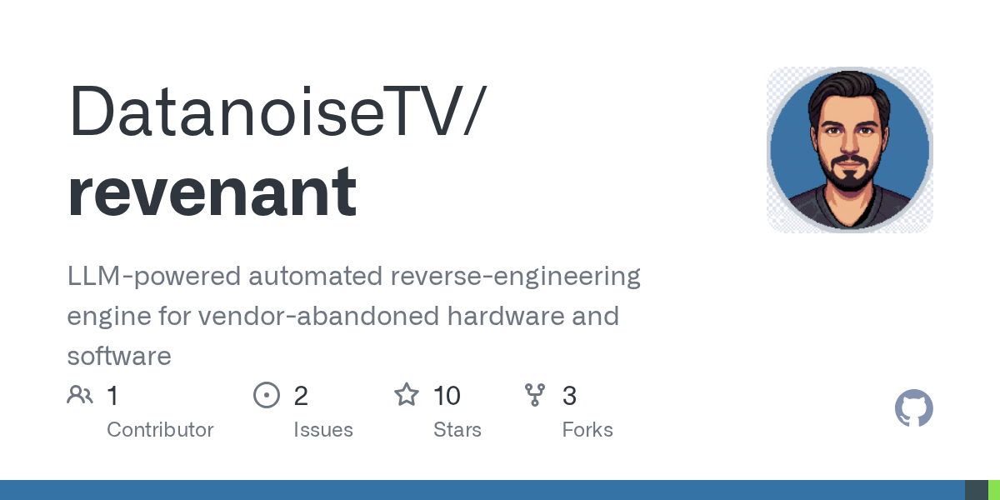</a></td><td><a href="https://github.com/DatanoiseTV/revenant"><b>revenant</b></a> DatanoiseTV</td><td>버려진 펌웨어와 바이너리를 LLM으로 자동 역공학하고 핀맵이나 재구현을 생성.</td><td>아니요</td><td>저장소 카드</td></tr>
<tr><td></td><td><a href="https://github.com/zhaofeng130/dsh-rea"><b>dsh-rea</b></a> zhaofeng130</td><td>DeepSeek Harness에 REA 스킬과 도구 추가</td><td>✅ 예</td><td>저장소 카드</td></tr>
<tr><td></td><td><a href="https://github.com/pablodiazjorge/rea-casebook"><b>rea-casebook</b></a> pablodiazjorge</td><td>Claude Code의 모든 결론에 실제 REA 증거를 인용하게</td><td>✅ 예</td><td>프로젝트 README</td></tr>
<tr><td></td><td><a href="https://github.com/sheilacraig/dsh-rea-mcp"><b>dsh-rea-mcp</b></a> sheilacraig</td><td>설정만으로 DeepSeek Harness에 REA 연결</td><td>✅ 예</td><td>저장소 카드</td></tr>
<tr><td></td><td><a href="https://github.com/Nowng/rea-mcp"><b>rea-mcp</b></a> Nowng</td><td>LM Studio 로컬 모델로 REA 사용</td><td>✅ 예</td><td>저장소 카드</td></tr>
<tr><td></td><td><a href="https://github.com/ya123-4/rea-dsh-plugin"><b>rea-dsh-plugin</b></a> ya123-4</td><td>DeepSeek Harness에 REA MCP 도구 등록</td><td>✅ 예</td><td>저장소 카드</td></tr>
<tr><td><a href="https://github.com/Sage-is/CleanRoom">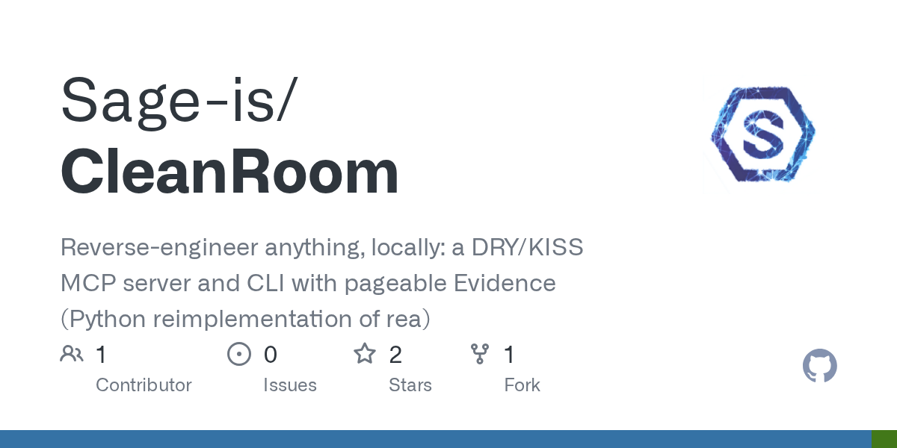</a></td><td><a href="https://github.com/Sage-is/CleanRoom"><b>CleanRoom</b></a> Sage-is</td><td>REA의 로컬 버전을 Python으로 단순하게 재구현한 MCP 서버와 CLI.</td><td>아니요</td><td>저장소 카드</td></tr>
<tr><td></td><td><a href="https://github.com/cognixws/picode-rea"><b>picode-rea</b></a> cognixws</td><td>PiCode에서 REA 정적 분석 도구 사용</td><td>✅ 예</td><td>저장소 카드</td></tr>
<tr><td></td><td><a href="https://github.com/jinshi666888/rea-playbook"><b>rea-playbook</b></a> jinshi666888</td><td>작은 Electron 타깃이 있는 REA 실습</td><td>✅ 예</td><td>프로젝트 README</td></tr>
<tr><td>—</td><td><a href="https://github.com/agioracle/rea-unity-game"><b>rea-unity-game</b></a> agioracle</td><td>에이전트로 Unity 게임을 역공학하는 워크플로</td><td>❔ 미확인</td><td>—</td></tr>
<tr><td><a href="https://github.com/orikami048/gea">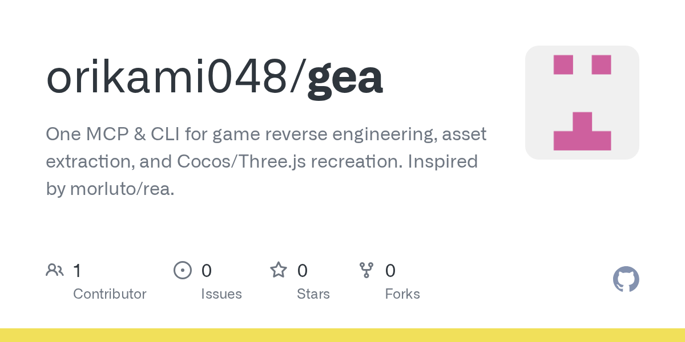</a></td><td><a href="https://github.com/orikami048/gea"><b>gea</b></a> orikami048</td><td>게임 리버스 엔지니어링, 에셋 추출, Cocos/Three.js 재현을 위한 MCP 및 CLI. morluto/rea에서 영감.</td><td>아니요</td><td>저장소 카드</td></tr>
<tr><td>—</td><td><a href="https://github.com/Stijnus/dsh-rev-eng"><b>dsh-rev-eng</b></a> Stijnus</td><td>REA 스킬과 선택적 MCP를 DSH 플러그인으로 패키징. 리버스 엔지니어링 및 Mac 앱 빌드용.</td><td>✅ 예</td><td>—</td></tr>
<tr><td>—</td><td><a href="https://github.com/CurLeaf/dsh-command-rea"><b>dsh-command-rea</b></a> CurLeaf</td><td>DSH /rea 슬래시 명령. 요청을 REA 스킬과 MCP 도구로 라우팅.</td><td>✅ 예</td><td>—</td></tr>
<tr><td>—</td><td><a href="https://github.com/LostArtefacts/decomp-tools"><b>decomp-tools</b></a> LostArtefacts</td><td>Windows 버전 툼 레이더 2~5의 일치하는 디컴파일을 돕는 도구. Wine에서 원본 MSVC 5/6 컴파일러를 사용합니다.</td><td>아니요</td><td>—</td></tr>
</table>

## REA 공식 쇼케이스

<table>
<tr><th width="170">이미지</th><th>프로젝트</th><th>소개</th><th>rea 사용</th><th>이미지 출처</th></tr>
<tr><td></td><td><a href="https://rea.tools/showcase/dx-ball/"><b>DX-Ball: sound-pan function</b></a></td><td>REA가 DX-Ball 사운드 함수를 바이트 단위로 같은 C로 복원하는 과정</td><td>✅ 예</td><td>자체 스크린샷</td></tr>
<tr><td></td><td><a href="https://rea.tools/showcase/notion/"><b>Notion: Electron clipboard bridge</b></a></td><td>Notion 복사 동작을 페이지에서 IPC, 메인 프로세스까지 추적</td><td>✅ 예</td><td>자체 스크린샷</td></tr>
<tr><td></td><td><a href="https://rea.tools/showcase/th04/"><b>TH04: PC-98 bullet-ring maths</b></a></td><td>16비트 DOS 코드에서 동방환상향 탄막 각도 계산을 복원</td><td>✅ 예</td><td>자체 스크린샷</td></tr>
<tr><td></td><td><a href="https://rea.tools/showcase/aegis/"><b>Aegis: TOTP code generation</b></a></td><td>Aegis 안드로이드 앱이 2단계 인증 코드를 만드는 방식을 해부</td><td>✅ 예</td><td>자체 스크린샷</td></tr>
<tr><td></td><td><a href="https://rea.tools/showcase/ctf/"><b>CTF: flag checker</b></a></td><td>DownUnderCTF 2023 리버싱 문제를 단계별로 풀이</td><td>✅ 예</td><td>자체 스크린샷</td></tr>
</table>

---

참고 / 감사: 많은 REA 커뮤니티 항목은 [AIshihzong/awesome-reverse-engineer-anything](https://github.com/AIshihzong/awesome-reverse-engineer-anything)을 참고해 확인했습니다.

기여 방법: [CONTRIBUTING.md](CONTRIBUTING.md). 라이선스: [CC0-1.0](LICENSE).
